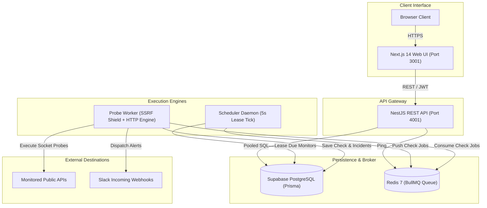

# PulseWatch — Enterprise API Monitoring & Incident Management Platform

[](#)
[](#)
[](#)
[](#)
[](#)
[](#)
[](#)
[](LICENSE)

> A distributed, high-throughput uptime monitoring and incident response platform engineered to detect outages, measure network latency with sub-millisecond precision, and safeguard worker infrastructure against Server-Side Request Forgery (SSRF) and DNS rebinding attacks.

---

## 1. Project Overview & Problem Statement

Modern cloud architectures rely on hundreds of distributed APIs, microservices, and third-party dependencies. Traditional monitoring solutions often introduce several operational challenges:
- **Alert Fatigue**: Transient network blips trigger false alarms, eroding on-call engineer trust.
- **SSRF Vulnerabilities**: Naive probers can be manipulated into scanning internal VPC networks or accessing cloud metadata services (`169.254.169.254`).
- **Database Starvation**: High-frequency monitoring checks quickly saturate database connection pools.
- **Dual-Write Inconsistencies**: Alert notifications often fail silently if decoupling mechanisms are absent.

**PulseWatch** resolves these challenges by combining:
1. **SSRF Defense with Socket IP Pinning**: Hostnames are resolved before connection, validated against private IP ranges, and pinned directly to the raw socket.
2. **3-Strike Hysteresis Incident State Machine**: Requires 3 consecutive failures to open an incident and 2 consecutive successes to resolve it.
3. **Optimized Aggregations & PgBouncer Pooling**: Employs batch `groupBy` queries and Supabase connection pooling to maintain high throughput with sub-50ms query latencies.
4. **Transactional Outbox & Slack Block Kit Alerting**: Stages alerts atomically with state transitions and delivers rich interactive cards directly to Slack channels.

---

## 2. Key Implemented Features

- **Distributed Microservices Topology**: Isolated deployable units for UI (`apps/web`), REST API (`apps/api`), Scheduler (`apps/scheduler`), and Probe Worker (`apps/worker`).
- **High-Precision HTTP Prober**: Native Node.js `http`/`https` socket client using `process.hrtime.bigint()` to measure DNS, TCP, TLS, TTFB, and total latency.
- **Automated Incident Lifecycle**: Deterministic state transitions (`OPEN` → `RECOVERING` → `RESOLVED`) with full event audit trails (`incident_events`).
- **Hardened Authentication**: Argon2id password hashing, HTTP-only cookie-based JWT sessions, refresh token rotation, and automatic reuse revocation.
- **Slack Incoming Webhook Integration**: Visual Block Kit alerts for service outages (Red card) and service recoveries (Green card).
- **Executive Analytics Dashboard**: Real-time rolling 24-hour uptime percentages, average latencies, and check timelines.

---

## 3. Technology Stack

- **Frontend**: Next.js 14 (App Router), React 18, Tailwind CSS, Recharts, Lucide React
- **Backend API**: NestJS 10, Express, Passport, class-validator, Argon2id
- **Database & Cache**: Supabase Managed PostgreSQL (Prisma ORM 5.10), Redis 7 (BullMQ)
- **Background Engines**: Node.js Autonomous Scheduler Daemon, BullMQ Distributed Probe Worker
- **Containerization**: Multi-stage Dockerfiles, Docker Compose production stack

---

## 4. System Architecture



For complete architectural details, see [docs/Architecture.md](docs/Architecture.md).

---

## 5. Project Folder Structure

```
Api_Monitoring_Platform/
├── apps/
│   ├── api/                  # NestJS 10 REST API Gateway
│   │   ├── src/common/       # Guards, filters, interceptors, decorators
│   │   └── src/modules/      # auth, monitors, incidents, dashboard, health
│   ├── scheduler/            # 5-second atomic lease scheduling daemon
│   ├── web/                  # Next.js 14 App Router dashboard & visualizations
│   └── worker/               # Distributed BullMQ probe worker & Slack dispatcher
├── packages/
│   ├── config/               # Zod-validated environment configuration
│   ├── database/             # Prisma schema, migrations, and database client
│   └── shared/               # TypeScript interfaces, DTOs, and constants
├── docs/                     # Project documentation specifications
│   ├── API_specification.md  # Complete REST API reference
│   ├── Architecture.md       # Architectural specifications & execution flows
│   └── Database.md           # Database ER diagram & table definitions
├── docker-compose.prod.yml   # Docker Compose production stack
├── package.json              # Monorepo root package configuration
└── turbo.json                # Turborepo build pipeline definition
```

---

## 6. Database Overview

PulseWatch persists all core application state inside PostgreSQL:
- **`users`**: Tenant accounts and Argon2id password hashes.
- **`refresh_tokens`**: Hashed refresh tokens with reuse revocation tracking.
- **`monitors`**: Health check configurations, schedules, and active statuses.
- **`monitoring_occurrences`**: Atomic scheduling slots and worker lease locks.
- **`monitor_checks`**: High-precision HTTP execution results and latency logs.
- **`incidents`**: Service outages triggered by 3 consecutive check failures.
- **`incident_events`**: Immutable audit logs of incident state transitions.
- **`monitor_hourly_aggregates` & `monitor_daily_aggregates`**: Pre-aggregated time rollups.
- **`outbox_events`**: Transactional outbox staging table for external webhook events.

For complete database schema and entity relationships, see [docs/Database.md](docs/Database.md).

---

## 7. Prerequisites & Environment Setup

Ensure your local machine has:
- **Node.js**: `v20.x` or higher (LTS)
- **pnpm**: `v8.x` or `v9.x` (`npm install -g pnpm`)
- **Docker & Docker Compose**: For local Redis and production stack execution
- **Supabase PostgreSQL**: Managed instance with PgBouncer connection pooling

### Environment Configuration
Copy `.env.example` to `.env`:
```bash
cp .env.example .env
```

Configure your environment variables:
```env
# Database Connections
DATABASE_URL="postgresql://postgres:[PASSWORD]@[HOST]:6543/postgres?pgbouncer=true"
DIRECT_URL="postgresql://postgres:[PASSWORD]@[HOST]:5432/postgres"

# Redis Queue Broker
REDIS_URL="redis://localhost:6379"

# Security Secrets (min 32 characters)
JWT_SECRET="your-cryptographically-secure-jwt-secret"
REFRESH_SECRET="your-cryptographically-secure-refresh-secret"

# Optional: Global Slack Webhook Alerting
SLACK_WEBHOOK_URL="https://hooks.slack.com/services/..."
```

---

## 8. Database Synchronization & Running the App

### Database Setup
```bash
# Push schema directly to database
pnpm --filter @pulsewatch/database db:push

# Generate Prisma Client typings
pnpm --filter @pulsewatch/database generate
```

### Running Locally (Development Mode)
Start Redis container:
```bash
docker run -d --name pulsewatch-redis -p 6379:6379 redis:7-alpine
```

Start all monorepo applications in watch mode:
```bash
pnpm dev
```

- **Web Dashboard**: `http://localhost:3000`
- **REST API**: `http://localhost:4000/api/v1`
- **Health Probe**: `http://localhost:4000/health`

---

## 9. API Modules Overview

The REST API exposes 19 fully tested endpoints:
- **Authentication (`/api/v1/auth`)**: Register, login, refresh tokens, logout, me.
- **Monitors (`/api/v1/monitors`)**: Create, list, details, update, enable, disable, delete, checks, metrics.
- **Incidents (`/api/v1/incidents`)**: List incidents, incident timeline with events.
- **Dashboard (`/api/v1/dashboard`)**: Executive summary statistics.
- **Health (`/health`, `/api/v1/health`)**: Database and Redis liveness checks.

For complete request/response contracts and status codes, see [docs/API_specification.md](docs/API_specification.md).

---

## 10. External Integrations: Slack Webhooks

PulseWatch supports automated Slack incident alerting:
1. Create an Incoming Webhook in your Slack workspace.
2. Set `SLACK_WEBHOOK_URL` in `.env`.
3. Verify alert dispatching with the built-in test utility:
   ```bash
   pnpm test:slack
   ```
   *Dispatches live simulated outage (Red card) and recovery (Green card) alerts.*

---

## 11. Testing & Verification

PulseWatch includes an automated 36-test system verification harness:
```bash
# Run full system verification suite (36 tests)
pnpm test:system

# Run TypeScript compilation and build
pnpm build

# Run linting across all packages
pnpm lint
```

---

## 12. Production Deployment (Docker Compose)

PulseWatch runs a production-ready container stack using multi-stage Docker builds:
```bash
# Build and start all 5 production containers
docker compose -f docker-compose.prod.yml up -d --build
```

### Production Host Port Mapping:
- **Web Interface**: `http://localhost:3001` (`pulsewatch-web-prod`)
- **API Gateway**: `http://localhost:4001` (`pulsewatch-api-prod`)
- **Isolated Redis**: `localhost:6380` (`pulsewatch-redis-prod`)
- **Background Engines**: `pulsewatch-scheduler-prod`, `pulsewatch-worker-prod`

---

## 13. Documentation References

For exhaustive technical references, consult the primary documentation:
- 📘 **[API Specification](docs/API_specification.md)** — Complete endpoint catalog, DTO validation, and JSON envelopes.
- 🏛️ **[System Architecture](docs/Architecture.md)** — Detailed execution flows, sequence diagrams, and SSRF defense engine.
- 🗄️ **[Database Specification](docs/Database.md)** — PostgreSQL ER diagram, table schemas, and indexing strategies.
