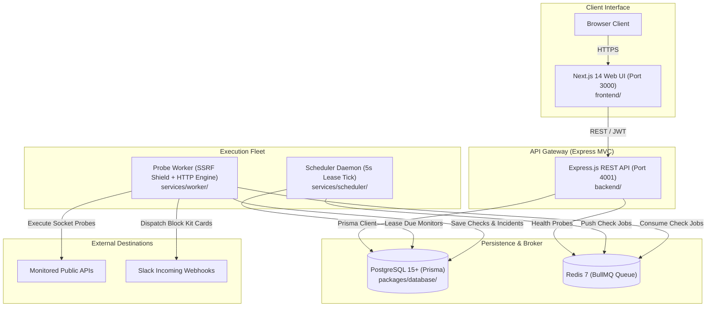

# PulseWatch — Enterprise API Monitoring & Incident Management Platform

[](#)
[](#)
[](#)
[](#)
[](#)
[](#)
[](LICENSE)

> A distributed, high-throughput uptime monitoring and incident response platform engineered to detect outages, measure network latency with sub-millisecond precision, and safeguard worker infrastructure against Server-Side Request Forgery (SSRF) and DNS rebinding attacks.

---

## 1. Project Overview & Problem Statement

Modern cloud architectures depend on hundreds of distributed microservices, public APIs, and third-party SaaS endpoints. Traditional monitoring tools suffer from critical shortcomings:
- **Alert Fatigue**: Transient network hiccups trigger immediate false alarms, eroding team trust in monitoring systems.
- **SSRF Vulnerabilities**: Naive probers can be coerced into scanning internal private subnets (RFC 1918) or querying cloud metadata endpoints (`169.254.169.254`).
- **Database Saturation**: High-frequency health checks quickly overwhelm database connection pools.
- **Dual-Write Failures**: Inconsistent state arises when incidents are logged in the database but notification alerts fail to deliver.

**PulseWatch** eliminates these issues through:
1. **SSRF Shield with Socket IP Pinning**: Pre-resolves DNS, blocks private/cloud subnets, and binds sockets directly to the verified public IP.
2. **3-Strike Hysteresis Incident State Machine**: Requires 3 consecutive check failures to declare an outage (`OPEN`) and 2 consecutive successes to confirm resolution (`RESOLVED`).
3. **Express.js MVC Architecture**: Clean decoupling of Controllers, Services, and Repositories for maximum maintainability and testability.
4. **Transactional Outbox Engine & Slack Block Kit Integration**: Stages alert events atomically within database transactions, delivering rich interactive cards to Slack.

---

## 2. Key Implemented Features

- **Next.js 14 App Router Frontend**: Server Components by default, responsive dashboard, real-time Recharts latency visualizations, and tenant isolation.
- **Express.js MVC Backend**: Decoupled layers (Controllers, Services, Repositories, Routes, Middlewares, Validators, Utils).
- **High-Precision HTTP Prober**: Custom Node.js socket client using `process.hrtime.bigint()` to track DNS, TCP, TLS, TTFB, and round-trip latency.
- **Hardened Authentication**: Argon2id password hashing, dual-token JWT sessions (15m access token), HttpOnly cookies, refresh token rotation, and reuse revocation.
- **Interactive Slack Alerts**: Real-time Block Kit notifications for service outages (Red card) and recoveries (Green card).
- **Docker Compose Orchestration**: Independent containers for `frontend`, `backend`, `postgres`, `redis`, `scheduler`, and `worker`.

---

## 3. Technology Stack

- **Frontend**: Next.js 14, React 18, TypeScript, Tailwind CSS, shadcn/ui, Recharts, Lucide React
- **Backend**: Node.js LTS, Express.js, TypeScript, MVC Pattern, Helmet, CORS, Argon2id, JWT, Zod
- **Database & Cache**: PostgreSQL 15+ (Prisma ORM 5.22), Redis 7 (BullMQ)
- **Background Fleet**: Node.js Autonomous Scheduler Daemon, BullMQ Distributed Probe Worker
- **Containerization**: Multi-stage Dockerfiles, Docker Compose

---

## 4. System Architecture



For complete architectural details, see [docs/Architecture.md](docs/Architecture.md).

---

## 5. Project Folder Structure

```
PulseWatch/
├── frontend/                 # Next.js 14 App Router client application
│   ├── src/
│   │   ├── app/              # /dashboard, /monitors, /incidents, /login, /register
│   │   ├── components/       # Recharts visualizations, navigation, modals
│   │   ├── context/          # Client AuthContext
│   │   ├── hooks/            # Custom React hooks
│   │   ├── lib/              # Centralized API client
│   │   ├── services/         # API integration services
│   │   └── types/            # Frontend TypeScript types
│   ├── public/               # Static assets & icons
│   ├── Dockerfile            # Multi-stage production container
│   ├── package.json
│   └── tsconfig.json
│
├── backend/                  # Express.js REST API with MVC Architecture
│   ├── src/
│   │   ├── config/           # Environment configuration via @pulsewatch/config
│   │   ├── controllers/      # HTTP request/response handlers
│   │   ├── services/         # Domain business logic & crypto
│   │   ├── repositories/     # Prisma data-access abstraction layer
│   │   ├── models/           # Domain models & entities
│   │   ├── routes/           # Express modular routers (/auth, /monitors, /incidents, /dashboard, /health)
│   │   ├── middlewares/      # JWT auth, Zod validation, error handling, rate limiting, logging
│   │   ├── validators/       # Zod schemas for request validation
│   │   ├── utils/            # JWT helpers, Argon2id, logger, errors, response formatters
│   │   ├── types/            # AuthenticatedRequest and backend types
│   │   ├── app.ts            # Express app configuration & middleware pipeline
│   │   └── server.ts         # Server bootstrap, DB healthcheck, graceful shutdown
│   ├── Dockerfile            # Multi-stage production container
│   ├── package.json
│   └── tsconfig.json
│
├── services/                 # Distributed background daemons
│   ├── scheduler/            # 5-second atomic lease scheduling daemon
│   │   ├── src/index.ts      # Lease polling & BullMQ job dispatch
│   │   └── Dockerfile
│   └── worker/               # Distributed probe execution worker
│       ├── src/              # Executor, SSRF validation, state machine, Slack alerting
│       └── Dockerfile
│
├── packages/                 # Shared monorepo libraries
│   ├── database/             # Prisma schema, migrations, and shared Prisma client
│   └── shared/               # Shared TypeScript types, enums, DTOs, and response envelopes
│
├── docs/                     # Project documentation specifications
│   ├── API_specification.md  # Complete REST API reference
│   ├── Architecture.md       # Architectural specifications & execution flows
│   └── Database.md           # Database ER diagram & table definitions
├── test/                     # Automated verification suites
│   ├── system-verification.ts# 36-test comprehensive verification harness
│   └── test-slack.ts         # Live Slack incoming webhook test utility
├── .env                      # Local environment configuration
├── .env.example              # Template environment configuration
├── docker-compose.yml        # Full-stack Docker Compose (frontend, backend, postgres, redis, scheduler, worker)
├── package.json              # Monorepo root package configuration
├── pnpm-workspace.yaml       # pnpm workspace definition
└── turbo.json                # Turborepo task pipeline definition
```

---

## 6. Database Overview

PulseWatch persists state in PostgreSQL via Prisma:
- **`users`**: Tenant accounts and Argon2id password hashes.
- **`refresh_tokens`**: Hashed refresh tokens with reuse revocation tracking.
- **`monitors`**: Health check parameters, intervals, and active states.
- **`monitoring_occurrences`**: Atomic scheduling slots and worker lease locks.
- **`monitor_checks`**: High-precision HTTP execution results and latency logs.
- **`incidents`**: Outages triggered by 3 consecutive check failures.
- **`incident_events`**: Immutable audit logs of incident state transitions.
- **`monitor_hourly_aggregates` & `monitor_daily_aggregates`**: Pre-aggregated time rollups.
- **`outbox_events`**: Transactional outbox staging table for external webhook alerts.

For complete database schema and entity relationships, see [docs/Database.md](docs/Database.md).

---

## 7. Prerequisites & Environment Setup

Ensure your local machine has:
- **Node.js**: `v20.x` or higher (LTS)
- **pnpm**: `v8.x` or `v9.x` (`npm install -g pnpm`)
- **Docker & Docker Compose**: For local containerized stack execution
- **PostgreSQL Database**: Local PostgreSQL 15+ or Supabase Managed Instance

### Environment Configuration
Copy `.env.example` to `.env`:
```bash
cp .env.example .env
```

Configure your environment variables:
```env
# Database Connections
DATABASE_URL="postgresql://postgres:[PASSWORD]@[HOST]:6543/postgres?pgbouncer=true"
DIRECT_URL="postgresql://postgres:[PASSWORD]@[HOST]:5432/postgres"

# Redis Queue Broker
REDIS_URL="redis://localhost:6379"

# Security Secrets (min 32 characters)
JWT_ACCESS_SECRET="your-cryptographically-secure-jwt-secret"
REFRESH_TOKEN_PEPPER="your-cryptographically-secure-refresh-pepper"

# Domains & Ports
FRONTEND_PORT=3000
BACKEND_PORT=4001
CORS_ORIGIN="http://localhost:3000"
NEXT_PUBLIC_API_URL="http://localhost:4001/api/v1"

# Optional: Slack Incoming Webhook
SLACK_WEBHOOK_URL="https://hooks.slack.com/services/..."
```

---

## 8. Database Synchronization & Running the App

### Database Setup
```bash
# Generate Prisma Client typings
pnpm db:generate

# Push schema directly to database
pnpm db:push
```

### Running Locally (Development Mode)
Start Redis container:
```bash
docker run -d --name pulsewatch-redis -p 6379:6379 redis:7-alpine
```

Start all monorepo applications in watch mode:
```bash
pnpm dev
```

- **Frontend Dashboard**: `http://localhost:3000`
- **Express REST API**: `http://localhost:4001/api/v1`
- **Health Check Probe**: `http://localhost:4001/health`

Individual service commands:
```bash
pnpm dev:frontend   # Starts only Next.js frontend
pnpm dev:backend    # Starts only Express backend
pnpm dev:scheduler  # Starts only Scheduler daemon
pnpm dev:worker     # Starts only Probe worker
```

---

## 9. Available API Modules

The Express REST API exposes 20 endpoints:
- **Authentication (`/api/v1/auth`)**: Register, login, refresh tokens, logout, me.
- **Monitors (`/api/v1/monitors`)**: Create, list, details, update, enable, disable, delete, checks, metrics.
- **Incidents (`/api/v1/incidents`)**: List incidents, incident details with events, update incident.
- **Dashboard (`/api/v1/dashboard`)**: Executive summary statistics.
- **Health (`/health`, `/ready`, `/api/v1/health`)**: Database and Redis liveness checks.

For complete request/response contracts and status codes, see [docs/API_specification.md](docs/API_specification.md).

---

## 10. External Integrations: Slack Webhooks

PulseWatch supports automated Slack incident alerting:
1. Create an Incoming Webhook in your Slack workspace.
2. Set `SLACK_WEBHOOK_URL` in `.env`.
3. Verify alert dispatching with the built-in test utility:
   ```bash
   pnpm test:slack
   ```
   *Dispatches live simulated outage (Red card) and recovery (Green card) alerts.*

---

## 11. Testing & Verification

PulseWatch includes an automated 36-test system verification harness:
```bash
# Run full system verification suite (36 tests)
pnpm test:system

# Run TypeScript compilation and build across all 7 packages
pnpm build

# Run live Slack webhook alert verification
pnpm test:slack
```

---

## 12. Production Deployment (Docker Compose)

PulseWatch runs a complete production container stack using multi-stage Docker builds:
```bash
# Build and start all 6 containers (frontend, backend, postgres, redis, scheduler, worker)
docker compose up -d --build
```

### Container Port Mapping:
- **Frontend UI**: `http://localhost:3000` (`pulsewatch-frontend`)
- **Backend API**: `http://localhost:4001` (`pulsewatch-backend`)
- **Internal Database**: `pulsewatch-postgres:5432`
- **Internal Cache**: `pulsewatch-redis:6379`
- **Background Daemons**: `pulsewatch-scheduler`, `pulsewatch-worker`

---

## 13. Documentation References

For exhaustive technical references, consult the primary documentation:
- 📘 **[API Specification](docs/API_specification.md)** — Complete endpoint catalog, DTO validation, and JSON envelopes.
- 🏛️ **[System Architecture](docs/Architecture.md)** — Detailed MVC flow, sequence diagrams, and SSRF defense engine.
- 🗄️ **[Database Specification](docs/Database.md)** — PostgreSQL ER diagram, table schemas, and indexing strategies.
