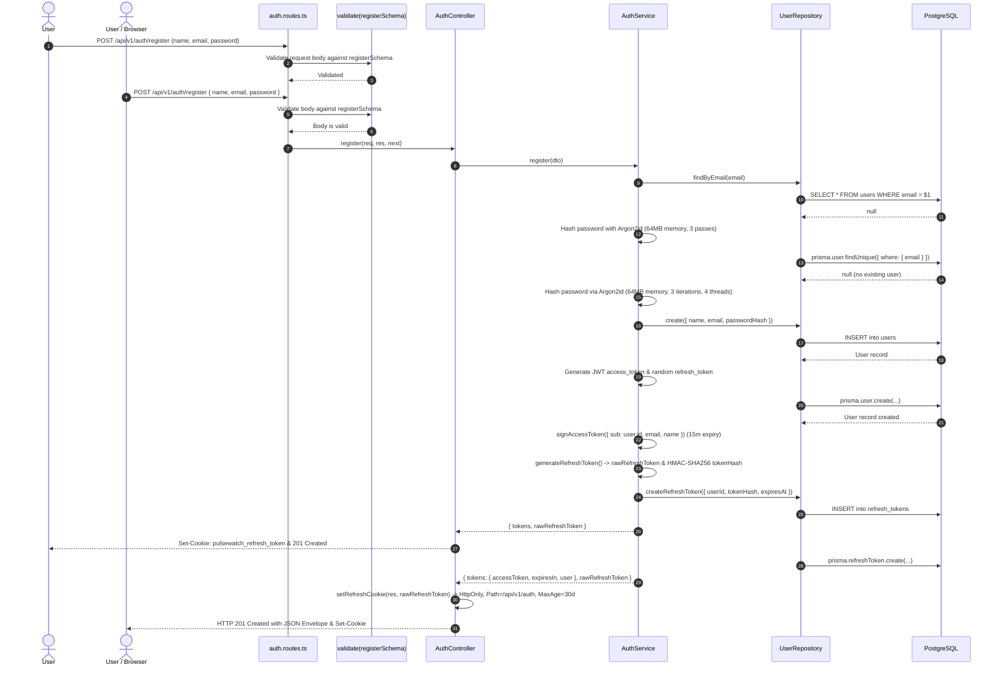
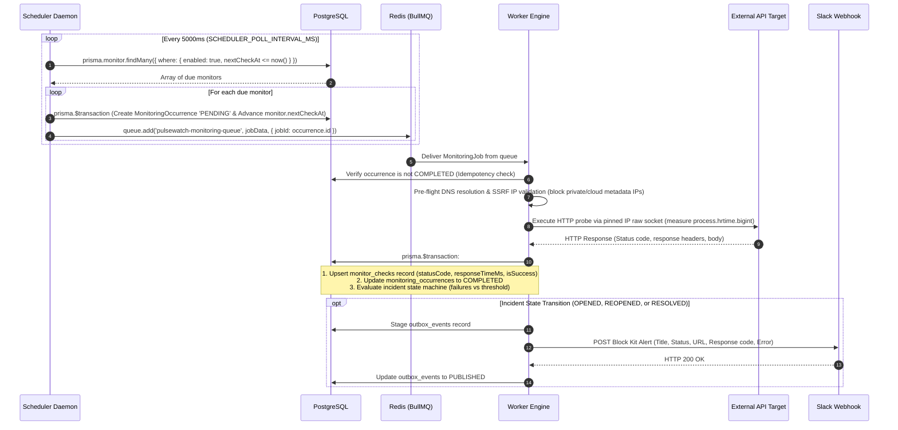

# PulseWatch — System Architecture & Design Specification

**Document:** `docs/Architecture.md`  
**Version:** 2.0.0  
**Status:** Production / Implemented  
**Architecture Style:** Modular Monorepo + Express.js MVC Backend + Next.js App Router Frontend + Distributed Probing Fleet  
**Repository Tooling:** npm Workspaces + Turborepo + Docker Compose
**Version:** 2.1.0  
**Status:** Implemented / Verified against Codebase  
**Architecture Style:** Modular Monorepo + Express.js MVC Backend + Next.js 14 App Router Frontend + Distributed Probing Engine  
**Repository Tooling:** npm Workspaces (`npm@11.20.0`) + Turborepo (`turbo@2.4.4`) + Docker Compose  

---

## 1. System Architecture Overview

PulseWatch is an API monitoring, uptime verification, and incident management platform. Its monorepo separates the **Next.js frontend**, **Express.js MVC backend**, background scheduling and probe execution services, and shared workspace packages.
PulseWatch is an enterprise-grade API monitoring, uptime verification, and incident management platform. The codebase is organized as a monorepo separating client web applications, an Express.js MVC REST API, autonomous background scheduling and probe execution services, and shared workspace packages.

### 1.1 Architectural Highlights
- **Layered MVC backend:** Controllers handle HTTP requests, services implement domain logic, and repositories provide database access through Prisma.
- **SSRF and DNS rebinding protection:** Before connecting, the probing engine resolves hostnames, blocks private and cloud metadata addresses (including RFC 1918, RFC 4193, and `169.254.169.254` ranges), and binds raw sockets to the verified IP address. This prevents a DNS response from changing between validation and connection (a TOCTOU attack).
- **High-resolution network timing:** `process.hrtime.bigint()` measures network round trips with sub-millisecond resolution.
- **Incident hysteresis:** An incident opens after three consecutive failures and resolves after two consecutive successes, reducing alerts caused by transient failures.
- **Transactional outbox:** Alert events (`outbox_events`) are staged atomically with monitor state changes so delivery can proceed without blocking probe execution.
- **Slack alerts:** Incoming webhooks deliver structured Block Kit messages for outages and recoveries.
- **Layered MVC Backend:** Clear separation of concerns where Controllers handle HTTP requests and validation, Services execute domain logic and coordination, and Repositories encapsulate database access through Prisma ORM.
- **Dual Deployment Topologies:**
  1. *Distributed Architecture:* Backend API, Scheduler daemon, and Probe Worker run as decoupled, independently scalable containers coordinated via Redis queues.
  2. *Embedded Architecture (`ENABLE_EMBEDDED_WORKERS=true`):* The Express server boots the Scheduler daemon and Worker inside the primary backend process (configured in `backend/src/server.ts`), enabling full platform functionality within a single web service container (e.g. on Render Free Tier).
- **SSRF & DNS Rebinding Shield:** Pre-flight DNS validation checks all resolved IPv4 and IPv6 addresses against private, loopback, carrier-grade NAT, link-local, and cloud metadata CIDR ranges (such as `169.254.169.254` and `fd00::/8`). Outgoing HTTP/HTTPS sockets are pinned directly to the verified IP address with the original `Host` header preserved, preventing Time-of-Check to Time-of-Use (TOCTOU) DNS rebinding attacks (`services/worker/src/ssrf.ts` & `executor.ts`).
- **High-Resolution Network Timing:** Raw socket lifecycle events and `process.hrtime.bigint()` measure network round trips with sub-millisecond precision (`services/worker/src/executor.ts`).
- **Incident Hysteresis Engine:** An incident is triggered only after $N$ consecutive check failures (default: 3) and automatically resolved after $M$ consecutive successes (default: 2), suppressing false alarms from transient network anomalies (`services/worker/src/incidents.ts`).
- **Transactional Outbox & Alerting:** Incident state transitions atomically stage alert records in the `outbox_events` table within the check transaction, followed by asynchronous delivery to Slack Incoming Webhooks with Block Kit payloads (`services/worker/src/slack.ts`).

---

## 2. High-Level System Architecture Diagram

```mermaid
flowchart TD
    subgraph ClientLayer ["Client & Frontend Layer"]
        BrowserUser["Engineer / Operator Browser"]
        NextWeb["Next.js 14 Web UI (Port 3000)\nfrontend/"]
    end

    subgraph ApiGatewayLayer ["Backend API Gateway (Express MVC)"]
        ExpressApi["Express.js REST API (Port 4001)\nbackend/"]
    subgraph ApiGatewayLayer ["Backend REST API (Express.js MVC)"]
        ExpressApi["Express.js REST API (Port 4001)\nbackend/src/"]
        Routes["Express Routers\n/api/v1 (auth, monitors, incidents, dashboard, health)"]
        Controllers["Controllers Layer\n(Auth, Monitor, Incident, Dashboard, Health)"]
        Services["Domain Services Layer\n(AuthService, MonitorService, IncidentService, HealthService)"]
        Repositories["Prisma Repositories Layer\n(UserRepository, MonitorRepository, IncidentRepository, DashboardRepository)"]
        
        ExpressApi --> Routes --> Controllers --> Services --> Repositories
    end

    subgraph DataStorageLayer ["Data Persistence & Message Broker"]
        PostgresDB[("PostgreSQL 15+ (Prisma ORM)\npackages/database/")]
        RedisQueue[("Redis 7 (BullMQ Queue Broker)")]
        RedisQueue[("Redis 7 (BullMQ Broker)\nQueue: pulsewatch-monitoring-queue")]
    end

    subgraph BackgroundExecutionLayer ["Autonomous Execution & Probing Fleet"]
        SchedulerDaemon["Scheduler Daemon (5s Atomic Leases)\nservices/scheduler/"]
        SchedulerDaemon["Scheduler Daemon (5s Poll / 60s Leases)\nservices/scheduler/"]
        WorkerProber["Worker Engine (SSRF Shield + HTTP Prober)\nservices/worker/"]
    end

    subgraph ExternalTargetsLayer ["External Targets & Alert Destinations"]
        ExternalApis["Target Public Endpoints"]
        SlackApi["Slack Incoming Webhooks API"]
        SlackApi["Slack Incoming Webhook API"]
    end

    BrowserUser -->|HTTPS| NextWeb
    NextWeb -->|REST API / JWT| ExpressApi
    ExpressApi -->|Prisma Client| PostgresDB
    ExpressApi -->|Health Probes| RedisQueue
    NextWeb -->|REST API / Bearer JWT| ExpressApi
    Repositories -->|Prisma Client| PostgresDB
    ExpressApi -.->|Health Probe Ping| RedisQueue

    SchedulerDaemon -->|Lease Due Monitors| PostgresDB
    SchedulerDaemon -->|Enqueue Check Jobs| RedisQueue
    SchedulerDaemon -->|Query Due Monitors & Claim Leases| PostgresDB
    SchedulerDaemon -->|Enqueue MonitoringJob| RedisQueue

    WorkerProber -->|Pull Check Jobs| RedisQueue
    WorkerProber -->|Execute Probe with IP Pinning| ExternalApis
    WorkerProber -->|Persist Check & Evaluate State| PostgresDB
    WorkerProber -->|Consume MonitoringJob| RedisQueue
    WorkerProber -->|DNS Validation & Pinned Socket Probe| ExternalApis
    WorkerProber -->|Persist MonitorCheck & Transition Incident| PostgresDB
    WorkerProber -->|Dispatch Block Kit Alert| SlackApi
```

---

## 3. Monorepo Directory Organization

```
PulseWatch/
├── frontend/                 # Next.js 14 App Router client application
├── frontend/                     # Next.js 14 App Router web application
│   ├── src/
│   │   ├── app/              # Routes: /dashboard, /monitors, /incidents, /login, /register
│   │   ├── components/       # UI components, Recharts visualizations, navigation
│   │   ├── context/          # Client state & AuthProvider
│   │   ├── hooks/            # Custom React hooks
│   │   ├── lib/              # Centralized API client & utilities
│   │   ├── services/         # Frontend API integration services
│   │   └── types/            # Frontend TypeScript types
│   ├── public/               # Static assets & icons
│   ├── Dockerfile            # Multi-stage production container
│   ├── package.json          # Dependencies: @pulsewatch/shared, next, react, recharts
│   │   ├── app/                  # App Router pages (/dashboard, /monitors, /monitors/[id], /incidents, /login, /register)
│   │   ├── components/           # UI layout, monitor modal, forms, Recharts components
│   │   ├── context/              # AuthContext and state providers
│   │   ├── hooks/                # Custom React hooks
│   │   ├── lib/                  # API client (apiRequest, token storage, 401 refresh interceptor)
│   │   └── types/                # Frontend TypeScript types
│   ├── public/                   # Static icons and assets
│   ├── Dockerfile                # Multi-stage production container (node:24-alpine)
│   ├── package.json              # Dependencies: @pulsewatch/shared, next, react, recharts, @tanstack/react-query
│   └── tsconfig.json
│
├── backend/                  # Express.js REST API with MVC Architecture
├── backend/                      # Express.js REST API with MVC Architecture
│   ├── src/
│   │   ├── config/           # Environment configuration via @pulsewatch/config
│   │   ├── controllers/      # HTTP request/response handlers (Auth, Monitor, Incident, Dashboard, Health)
│   │   ├── services/         # Domain business rules & repository coordination
│   │   ├── repositories/     # Prisma data-access abstraction layer
│   │   ├── models/           # Domain models & entities
│   │   ├── routes/           # Express modular routers (/auth, /monitors, /incidents, /dashboard, /health)
│   │   ├── middlewares/      # JWT auth, Zod validation, error handling, rate limiting, logging
│   │   ├── validators/       # Zod schemas for request validation
│   │   ├── utils/            # JWT helpers, Argon2id, logger, custom error classes, response formatters
│   │   ├── types/            # AuthenticatedRequest and backend types
│   │   ├── app.ts            # Express app configuration & middleware pipeline
│   │   └── server.ts         # Server bootstrap, DB healthcheck, graceful shutdown
│   ├── Dockerfile            # Multi-stage production container
│   ├── package.json          # Dependencies: express, helmet, cors, argon2, jsonwebtoken, zod
│   │   ├── config/               # Configuration wrapper over @pulsewatch/config
│   │   ├── controllers/          # HTTP controllers (auth, monitor, incident, dashboard, health)
│   │   ├── services/             # Domain business logic & crypto/token orchestration
│   │   ├── repositories/         # Prisma data-access abstraction layer
│   │   ├── routes/               # Modular Express routers mounted at /api/v1 (and /api/vi alias)
│   │   ├── middlewares/          # JWT authenticate, Zod validate, rate limiting, error handling, logging
│   │   ├── validators/           # Zod schemas for request validation (auth, monitor, incident)
│   │   ├── utils/                # JWT sign/verify, Argon2id hashing, logger, errors, response formatters
│   │   ├── types/                # AuthenticatedRequest and backend internal types
│   │   ├── app.ts                # Express app setup, CORS, Helmet, middleware pipeline
│   │   └── server.ts             # Server bootstrap, DB health check, embedded worker lifecycle, graceful shutdown
│   ├── Dockerfile                # Multi-stage production container (node:24-alpine)
│   ├── package.json              # Dependencies: express, helmet, cors, argon2, jsonwebtoken, zod
│   └── tsconfig.json
│
├── services/                 # Distributed background daemons
│   ├── scheduler/            # 5-second atomic lease scheduling daemon
│   │   ├── src/index.ts      # Lease polling & BullMQ job dispatch
│   │   └── Dockerfile
│   └── worker/               # Distributed probe execution worker
├── services/                     # Autonomous background daemons
│   ├── scheduler/                # Monitor scheduling service
│   │   ├── src/index.ts          # 5-second polling loop, atomic occurrence claiming, BullMQ job dispatch
│   │   ├── Dockerfile            # Multi-stage production container (node:24-alpine)
│   │   └── package.json          # Dependencies: @pulsewatch/config, @pulsewatch/database, bullmq, ioredis
│   └── worker/                   # Distributed probe execution worker
│       ├── src/
│       │   ├── executor.ts   # Raw socket HTTP client with microsecond timing
│       │   ├── ssrf.ts       # SSRF pre-flight DNS validation & IP pinning
│       │   ├── incidents.ts  # 3-strike outage / 2-strike recovery state machine
│       │   ├── slack.ts      # Slack Block Kit notification dispatcher
│       │   └── index.ts      # BullMQ worker consumer
│       └── Dockerfile
│       │   ├── executor.ts       # Raw HTTP/HTTPS socket client with sub-millisecond process.hrtime timing
│       │   ├── ssrf.ts           # Pre-flight DNS resolution, private IP/CIDR blocking, socket IP pinning
│       │   ├── incidents.ts      # Incident state machine (3-strike outage, 2-strike recovery)
│       │   ├── slack.ts          # Slack Block Kit notification dispatcher
│       │   └── index.ts          # BullMQ queue consumer (queue: pulsewatch-monitoring-queue)
│       ├── Dockerfile            # Multi-stage production container (node:24-alpine)
│       └── package.json          # Dependencies: @pulsewatch/config, @pulsewatch/database, @pulsewatch/shared, bullmq, ioredis
│
├── packages/                 # Shared monorepo libraries
│   ├── database/             # Prisma schema, migrations, and shared Prisma client
│   └── shared/               # Shared TypeScript types, enums, DTOs, and response envelopes
├── packages/                     # Shared monorepo packages
│   ├── config/                   # Centralized environment validation and constants
│   │   ├── src/index.ts          # Zod envSchema, getEnv(), QUEUE_NAMES, CONSTANTS
│   │   └── package.json
│   ├── database/                 # Prisma ORM layer
│   │   ├── prisma/
│   │   │   ├── schema.prisma     # PostgreSQL models, enums, indexes, relation rules
│   │   │   └── migrations/       # Prisma migration history
│   │   ├── src/index.ts          # Instantiated PrismaClient singleton and connection health helpers
│   │   └── package.json          # Prisma CLI, dotenv-cli, @prisma/client
│   └── shared/                   # Cross-package TypeScript interfaces and DTOs
│       ├── src/index.ts          # Domain enums, ApiResponse, UserDto, MonitorDto, IncidentDto, MonitoringJob
│       └── package.json
│
├── docs/                     # Project documentation specifications
│   ├── API_specification.md  # Complete REST API reference
│   ├── Architecture.md       # Architectural specifications & execution flows
│   └── Database.md           # Database ER diagram & table definitions
├── test/                     # Automated verification suites
│   ├── system-verification.ts# 36-test comprehensive verification harness
│   └── test-slack.ts         # Live Slack incoming webhook test utility
├── .env                      # Local environment configuration
├── .env.example              # Template environment configuration
├── docker-compose.yml        # Full-stack Docker Compose (frontend, backend, postgres, redis, scheduler, worker)
├── package.json              # Monorepo root package configuration
├── package-lock.json         # npm dependency lockfile
└── turbo.json                # Turborepo task pipeline definition
├── docs/                         # Project technical documentation
│   ├── API_specification.md      # Exhaustive REST API specification
│   ├── Architecture.md           # System architecture, monorepo layout, and runtime flows
│   └── Database.md               # Database schema, table definitions, and ER diagram
│
├── test/                         # Verification harnesses and test suites
│   ├── api-endpoints.test.ts     # 29-test comprehensive API endpoint and auth contract verification suite
│   ├── system-verification.ts    # System lifecycle and health test harness
│   └── test-slack.ts             # Slack webhook integration verification utility
│
├── docker-compose.yml            # Multi-container orchestration (postgres, redis, backend, scheduler, worker, frontend)
├── docker-compose.prod.yml       # Production Docker Compose specification
├── render.yaml                   # Render Blueprint deployment configuration
├── package.json                  # Root npm workspace configuration (npm@11.20.0)
├── package-lock.json             # Root npm lockfile
└── turbo.json                    # Turborepo task pipeline configuration
```

---

## 4. Express.js MVC Architecture

The backend uses a layered **Model-View-Controller (MVC)** pattern:
The REST API strictly adheres to a layered **Model-View-Controller (MVC)** architectural pattern:

```
[ HTTP Request ]
       |
       v
[ Express Middleware Pipeline ] -> Helmet, CORS, Cookie-Parser, JSON Parser, Logger, Rate-Limiter
       |
       v
[ Route Layer (routes/) ] -------> Matches path, runs Auth & Zod Validation Middlewares
       |
       v
[ Controller Layer (controllers/) ] -> Parses input, calls Service, sends Standard JSON Response
       |
       v
[ Service Layer (services/) ] -------> Executes business rules, orchestrates Repositories, handles crypto/JWT
       |
       v
[ Repository Layer (repositories/) ]-> Encapsulates Prisma queries against PostgreSQL
       |
       v
[ Database (packages/database/) ] ---> Executes SQL queries
[ Incoming HTTP Request ]
       │
       ▼
[ Middleware Pipeline ] ────────► Helmet, CORS, Cookie-Parser, JSON Parser, Logger, Rate-Limiters
       │
       ▼
[ Routing Layer (routes/) ] ────► Matches URL path, applies authenticate & Zod validate middleware
       │
       ▼
[ Controller Layer ] ───────────► Unpacks req.body/params/query, calls Service, calls sendSuccess/sendError
       │
       ▼
[ Domain Service Layer ] ───────► Executes business logic, Argon2id hashing, JWT signing, IDOR authorization
       │
       ▼
[ Repository Layer ] ───────────► Executes typed queries via PrismaClient singleton
       │
       ▼
[ PostgreSQL Database ] ────────► Executes SQL queries, enforces constraints and transactions
```

### 4.1 Controllers
- Handle HTTP requests, extract parameters, body, and query values, invoke services, and format standardized responses (`sendSuccess` / `sendError`).
- Never perform raw database queries or complex calculations.
### 4.1 Controllers (`backend/src/controllers/`)
- Extract validated parameters, query strings, and request bodies.
- Delegate all domain operations to corresponding domain services.
- Never write direct SQL or invoke Prisma directly.
- Return structured envelopes via `sendSuccess(res, message, data, statusCode, meta)` or pass errors to `next(error)`.

### 4.2 Services
- Implement business logic such as Argon2id password hashing, JWT signing, refresh-token rotation, IDOR permission checks, and aggregation calculations.
### 4.2 Services (`backend/src/services/`)
- Encapsulate business logic, such as Argon2id cryptographic hashing (`memoryCost: 65536`, `timeCost: 3`, `parallelism: 4`), JWT token generation, refresh token hash generation and rotation, and tenant ownership checks.
- Handle transactional orchestration across repositories.

### 4.3 Repositories
- Encapsulate database queries through the shared `@pulsewatch/database` Prisma client.
- Provide clean async methods (`create`, `findById`, `findMany`, `update`, `delete`, `get24hStats`).
### 4.3 Repositories (`backend/src/repositories/`)
- Directly interact with `@pulsewatch/database` Prisma client.
- Provide clean async data-access interfaces (`create`, `findById`, `findMany`, `update`, `delete`, `getBatch24hStats`, `getMetrics`).
- Implement application-level transactional cascading deletes in `MonitorRepository.delete(id)` to safely clean up all child checks, occurrences, incidents, and aggregates.

---

## 5. Core Execution Flows

### 5.1 User Registration & Authentication Lifecycle



### 5.2 Monitor Scheduling & Probe Execution
1. **Scheduler tick:** The scheduler daemon (`services/scheduler`) polls PostgreSQL every five seconds for enabled monitors whose `nextCheckAt` is due.
2. **Lease advance:** In one database transaction, the scheduler advances `nextCheckAt` by the monitor interval and creates a `PENDING` `monitoring_occurrences` record with a 60-second lease.
3. **Queue dispatch:** The scheduler enqueues a check job in the BullMQ `monitor-checks` queue, backed by Redis.
4. **Probe execution:** A worker in `services/worker` consumes the job, validates DNS to guard against SSRF, pins the raw socket to the verified public IP, and performs the HTTP probe with high-resolution timing.
5. **State update and alerting:** The worker saves the result to `monitor_checks`. After three consecutive failures, it opens an incident and stages an `INCIDENT_OPENED` outbox event for Slack delivery. After two consecutive successes, it resolves the incident and dispatches a recovery alert.
---

### 5.2 Monitor Scheduling & Probe Execution Flow



---

## 6. Security Architecture

1. **SSRF Mitigation:**
   - Targets are validated before any TCP socket connection is initiated (`services/worker/src/ssrf.ts`).
   - Hostnames resolving to private IPv4 ranges (`10.0.0.0/8`, `172.16.0.0/12`, `192.168.0.0/16`), loopback (`127.0.0.0/8`), link-local / AWS metadata (`169.254.0.0/16`), or private IPv6 (`fc00::/7`, `fe80::/10`, `::1`) are immediately rejected with `SSRF_VIOLATION`.
   - The connection is established directly to the verified `pinnedIp` while transmitting the legitimate `Host` header to bypass DNS rebinding vectors.
2. **Password Security:**
   - Passwords are encrypted using Argon2id (`argon2.argon2id`) with high memory and iteration parameters (`memoryCost: 65536`, `timeCost: 3`, `parallelism: 4`).
3. **Session & Cookie Security:**
   - Access tokens are short-lived (15 minutes).
   - Refresh tokens are long-lived (30 days) and stored in the database exclusively as HMAC-SHA256 hashes (`token_hash`).
   - The raw refresh token is transmitted solely via an `HttpOnly`, `Path=/api/v1/auth`, `SameSite=Strict` cookie, rendering it inaccessible to client JavaScript.
4. **Tenant Isolation:**
   - Every read and write query in repositories scopes operations by the authenticated `userId` extracted from the verified JWT payload.
