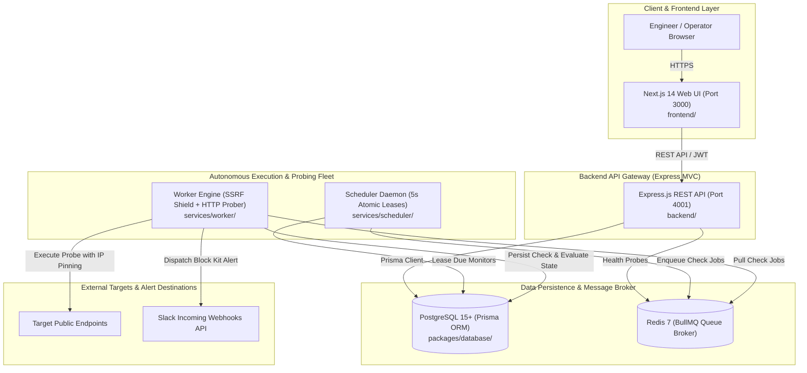
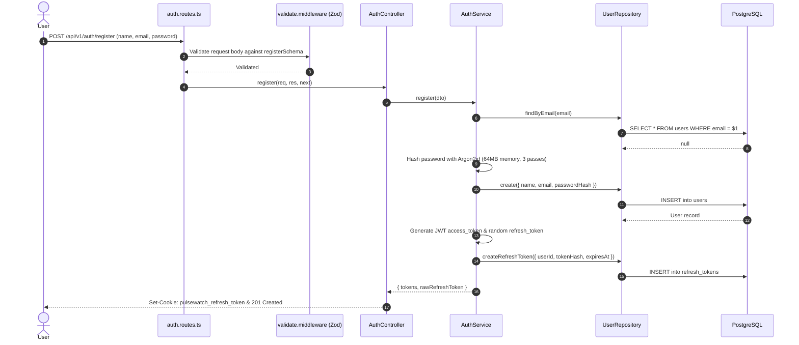

# PulseWatch — System Architecture & Design Specification

**Document:** `docs/Architecture.md`  
**Version:** 2.0.0  
**Status:** Production / Implemented  
**Architecture Style:** Modular Monorepo + Express.js MVC Backend + Next.js App Router Frontend + Distributed Probing Fleet  
**Repository Tooling:** pnpm Workspaces + Turborepo + Docker Compose

---

## 1. System Architecture Overview

PulseWatch is an enterprise-grade API monitoring, uptime verification, and incident management platform. Following a complete architectural migration, PulseWatch is structured as a production-ready monorepo separating concerns into a **Next.js frontend**, an **Express.js MVC backend**, independent **background scheduling and probe execution services**, and **shared workspace packages**.

### 1.1 Architectural Highlights
- **Clear Separation of Concerns (MVC)**: The backend is organized around Model-View-Controller principles with decoupled **Controllers** (HTTP handling & status codes), **Services** (domain logic & orchestration), and **Repositories** (Prisma database data-access layer).
- **Zero-Tolerance SSRF & DNS Rebinding Shield**: Probing engine resolves DNS hostnames before socket connection, blocks private/cloud-metadata IPs (RFC 1918, RFC 4193, `169.254.169.254`), and strictly binds raw sockets to the verified IP to prevent Time-of-Check to Time-of-Use (TOCTOU) DNS rebinding attacks.
- **Microsecond Precision Network Timers**: Employs `process.hrtime.bigint()` to capture network round-trips with sub-millisecond precision.
- **Hysteresis Incident State Machine**: Eliminates alert fatigue and transient false positives via 3-strike failure threshold for outages and 2-strike consecutive success threshold for automated recovery.
- **Transactional Outbox Engine**: Stages alert events (`outbox_events`) atomically with monitor state transitions to guarantee delivery without blocking probe execution.
- **Global Slack Incoming Webhooks**: Delivers structured Block Kit cards to Slack channels for outage and recovery alerts.

---

## 2. High-Level System Architecture Diagram



---

## 3. Monorepo Directory Organization

```
PulseWatch/
├── frontend/                 # Next.js 14 App Router client application
│   ├── src/
│   │   ├── app/              # Routes: /dashboard, /monitors, /incidents, /login, /register
│   │   ├── components/       # UI components, Recharts visualizations, navigation
│   │   ├── context/          # Client state & AuthProvider
│   │   ├── hooks/            # Custom React hooks
│   │   ├── lib/              # Centralized API client & utilities
│   │   ├── services/         # Frontend API integration services
│   │   └── types/            # Frontend TypeScript types
│   ├── public/               # Static assets & icons
│   ├── Dockerfile            # Multi-stage production container
│   ├── package.json          # Dependencies: @pulsewatch/shared, next, react, recharts
│   └── tsconfig.json
│
├── backend/                  # Express.js REST API with MVC Architecture
│   ├── src/
│   │   ├── config/           # Environment configuration via @pulsewatch/config
│   │   ├── controllers/      # HTTP request/response handlers (Auth, Monitor, Incident, Dashboard, Health)
│   │   ├── services/         # Domain business rules & repository coordination
│   │   ├── repositories/     # Prisma data-access abstraction layer
│   │   ├── models/           # Domain models & entities
│   │   ├── routes/           # Express modular routers (/auth, /monitors, /incidents, /dashboard, /health)
│   │   ├── middlewares/      # JWT auth, Zod validation, error handling, rate limiting, logging
│   │   ├── validators/       # Zod schemas for request validation
│   │   ├── utils/            # JWT helpers, Argon2id, logger, custom error classes, response formatters
│   │   ├── types/            # AuthenticatedRequest and backend types
│   │   ├── app.ts            # Express app configuration & middleware pipeline
│   │   └── server.ts         # Server bootstrap, DB healthcheck, graceful shutdown
│   ├── Dockerfile            # Multi-stage production container
│   ├── package.json          # Dependencies: express, helmet, cors, argon2, jsonwebtoken, zod
│   └── tsconfig.json
│
├── services/                 # Distributed background daemons
│   ├── scheduler/            # 5-second atomic lease scheduling daemon
│   │   ├── src/index.ts      # Lease polling & BullMQ job dispatch
│   │   └── Dockerfile
│   └── worker/               # Distributed probe execution worker
│       ├── src/
│       │   ├── executor.ts   # Raw socket HTTP client with microsecond timing
│       │   ├── ssrf.ts       # SSRF pre-flight DNS validation & IP pinning
│       │   ├── incidents.ts  # 3-strike outage / 2-strike recovery state machine
│       │   ├── slack.ts      # Slack Block Kit notification dispatcher
│       │   └── index.ts      # BullMQ worker consumer
│       └── Dockerfile
│
├── packages/                 # Shared monorepo libraries
│   ├── database/             # Prisma schema, migrations, and shared Prisma client
│   └── shared/               # Shared TypeScript types, enums, DTOs, and response envelopes
│
├── docs/                     # Project documentation specifications
│   ├── API_specification.md  # Complete REST API reference
│   ├── Architecture.md       # Architectural specifications & execution flows
│   └── Database.md           # Database ER diagram & table definitions
├── test/                     # Automated verification suites
│   ├── system-verification.ts# 36-test comprehensive verification harness
│   └── test-slack.ts         # Live Slack incoming webhook test utility
├── .env                      # Local environment configuration
├── .env.example              # Template environment configuration
├── docker-compose.yml        # Full-stack Docker Compose (frontend, backend, postgres, redis, scheduler, worker)
├── package.json              # Monorepo root package configuration
├── pnpm-workspace.yaml       # pnpm workspace definition
└── turbo.json                # Turborepo task pipeline definition
```

---

## 4. Express.js MVC Architecture

The backend implements a clean, layered **MVC (Model-View-Controller)** pattern:

```
[ HTTP Request ]
       |
       v
[ Express Middleware Pipeline ] -> Helmet, CORS, Cookie-Parser, JSON Parser, Logger, Rate-Limiter
       |
       v
[ Route Layer (routes/) ] -------> Matches path, runs Auth & Zod Validation Middlewares
       |
       v
[ Controller Layer (controllers/) ] -> Parses input, calls Service, sends Standard JSON Response
       |
       v
[ Service Layer (services/) ] -------> Executes business rules, orchestrates Repositories, handles crypto/JWT
       |
       v
[ Repository Layer (repositories/) ]-> Encapsulates Prisma queries against PostgreSQL
       |
       v
[ Database (packages/database/) ] ---> Executes SQL queries
```

### 4.1 Controllers
- Exclusively handle HTTP requests, extract parameters/body/query, invoke services, and format standardized responses (`sendSuccess` / `sendError`).
- Never perform raw database queries or complex calculations.

### 4.2 Services
- Implement business logic, such as password hashing via Argon2id, JWT token signing, refresh token rotation, IDOR permission checks, and aggregation calculations.

### 4.3 Repositories
- Encapsulate all database queries via the shared `@pulsewatch/database` Prisma client.
- Provide clean async methods (`create`, `findById`, `findMany`, `update`, `delete`, `get24hStats`).

---

## 5. Core Execution Flows

### 5.1 User Registration & Authentication Lifecycle


### 5.2 Monitor Scheduling & Probe Execution
1. **Scheduler Tick**: The autonomous scheduler daemon (`services/scheduler`) polls PostgreSQL every 5 seconds for monitors with `enabled = true` and `nextCheckAt <= now()`.
2. **Atomic Lease Advance**: In a single database transaction, the scheduler advances `nextCheckAt = now() + intervalSeconds` and records a `PENDING` `monitoring_occurrences` record with a 60-second lease expiration.
3. **Queue Dispatch**: The check job is enqueued to Redis via BullMQ (`monitor-checks` queue).
4. **Worker Prober**: A worker in `services/worker` consumes the job, performs pre-flight SSRF DNS validation, binds raw sockets to the verified public IP (defeating DNS rebinding), and executes the HTTP probe using nanosecond timers.
5. **State Machine & Slack Alert**: The check result is saved to `monitor_checks`. If consecutive failures hit 3, an incident is created (`OPEN`), an outbox event is staged (`INCIDENT_OPENED`), and a Slack Block Kit card is delivered. When 2 consecutive successes occur, the incident is updated to `RESOLVED` and a recovery alert is dispatched.
