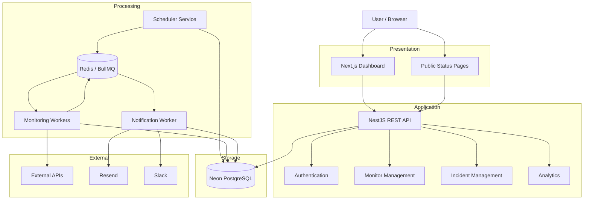
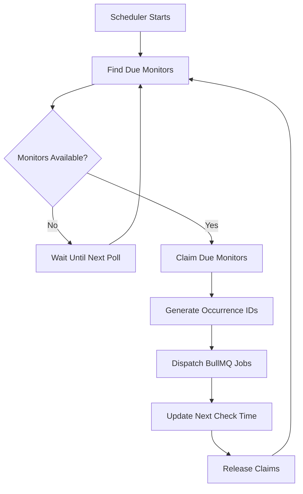
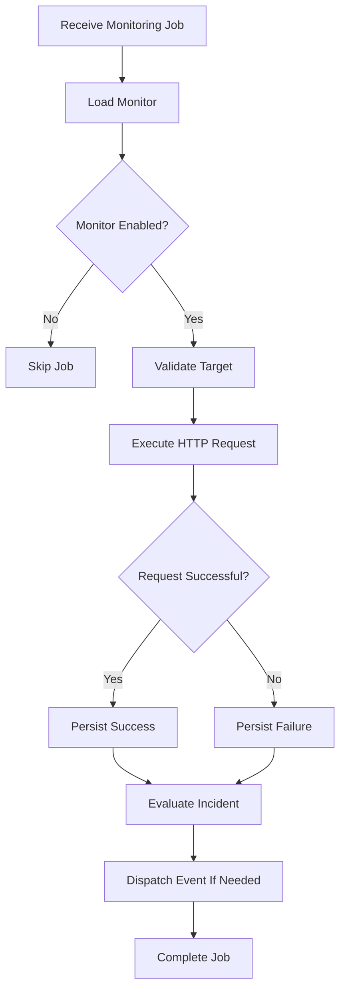
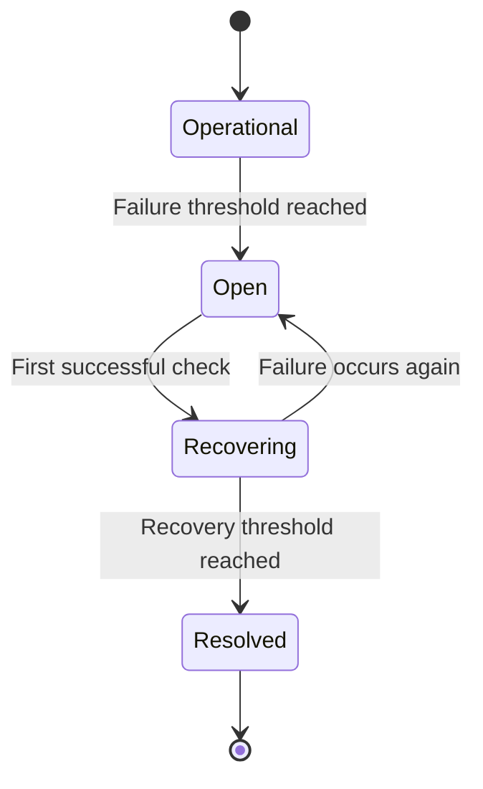
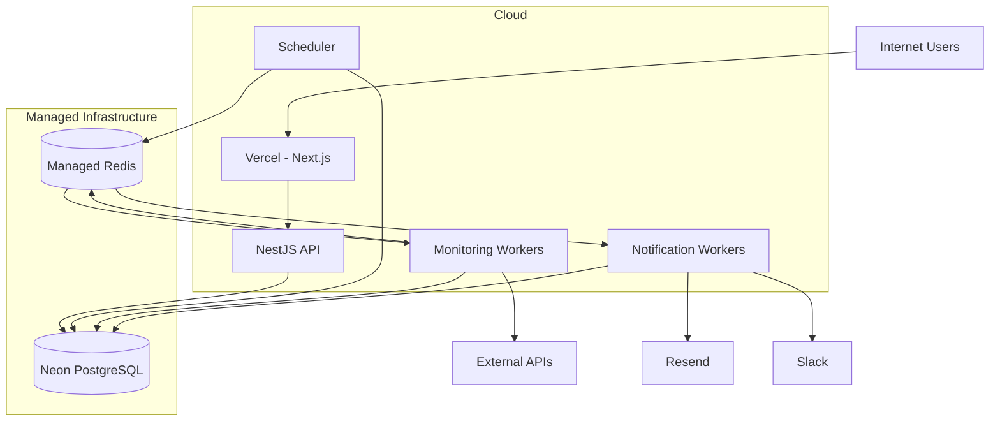

# PulseWatch — System Architecture & Technology Stack

**Document:** ARCHITECTURE.md  
**Version:** 1.0  
**Status:** Draft — Architecture Definition  
**Project:** PulseWatch  
**Based on:** PRD v1.0

---

# 1. Architecture Overview

PulseWatch follows a **Modular Monorepo + Distributed Services + Event-Driven Background Processing** architecture.

The system separates user-facing API operations from scheduled monitoring and background job execution.

## 1.1 Architecture Objectives

- Separate API request processing from monitoring execution.
- Support multiple monitoring workers.
- Execute scheduled checks reliably.
- Prevent duplicate monitoring results and incidents.
- Handle worker failures and service restarts.
- Store monitoring history reliably.
- Scale API servers and workers independently.
- Protect monitoring infrastructure against SSRF.
- Support future multi-region monitoring.
- Maintain a clean and scalable codebase.

# 2. Technology Stack

## 2.1 Frontend

| Technology | Purpose |
|---|---|
| Next.js | Frontend framework |
| React | UI development |
| TypeScript | Type safety |
| Tailwind CSS | Styling |
| shadcn/ui | UI components |
| Recharts | Historical analytics |
| React Hook Form | Form management |
| Zod | Client-side validation |
| TanStack Query | API state management |

## 2.2 Backend

| Technology | Purpose |
|---|---|
| NestJS | Backend framework |
| Node.js | Runtime |
| TypeScript | Programming language |
| REST API | Client-server communication |
| Prisma ORM | Database access |
| class-validator | Request validation |
| JWT | Authentication |
| Argon2id | Password hashing |

## 2.3 Database and Infrastructure

| Technology | Purpose |
|---|---|
| Neon PostgreSQL | Primary database |
| Prisma | ORM and migrations |
| Redis | Queue backend |
| BullMQ | Background job processing |
| Docker | Containerization |
| Docker Compose | Local infrastructure |
| pnpm | Package management |
| Turborepo | Monorepo management |

## 2.4 Background Processing

| Technology | Purpose |
|---|---|
| Node.js | Scheduler and worker runtime |
| BullMQ | Job queues |
| Redis | Queue storage |
| Axios or native fetch | HTTP requests |
| Prisma | Database operations |

Use a dedicated HTTP client implementation with strict redirect, DNS, timeout, and IP validation for monitoring targets.

## 2.5 External Integrations

| Service | Purpose |
|---|---|
| Resend | Email notifications |
| Slack Incoming Webhooks | Slack alerts |
| Vercel | Frontend deployment |
| GitHub | Version control |

## 2.6 Testing

| Technology | Purpose |
|---|---|
| Jest | Unit testing |
| Supertest | API integration testing |
| Playwright | End-to-end testing |
| k6 | Load testing |

# 3. High-Level Architecture

PulseWatch contains four primary layers:

1. Presentation Layer
2. Application Layer
3. Background Processing Layer
4. Data and Infrastructure Layer

## 3.1 System Architecture Diagram



# 4. Service Architecture

PulseWatch consists of independently executable services.

| Service | Technology | Responsibility |
|---|---|---|
| Web | Next.js | User interface |
| API | NestJS | Authentication and business logic |
| Scheduler | Node.js | Identify monitors due for checks |
| Worker | Node.js | Execute HTTP health checks |
| Notification Worker | Node.js | Deliver notifications |
| Database | Neon PostgreSQL | Persistent storage |
| Queue | Redis + BullMQ | Asynchronous job processing |

Each service should be independently deployable.

The services may share common packages, database infrastructure, and TypeScript contracts.

# 5. Core Application Modules

## 5.1 Authentication Module

Responsibilities:

- User registration.
- User login.
- User logout.
- Access token generation.
- Refresh token rotation.
- Password hashing.
- Authentication guards.
- User ownership verification.

Dependencies:

- PostgreSQL
- Prisma
- NestJS

## 5.2 Monitor Module

Responsibilities:

- Create monitors.
- Update monitors.
- Delete monitors.
- Enable and disable monitors.
- Validate monitor configurations.
- Retrieve monitoring information.

Important rule:

Monitor CRUD operations must never directly execute HTTP health checks.

The API manages monitor configuration. The scheduler and workers handle monitoring execution.

## 5.3 Scheduler Module

Responsibilities:

- Find monitors due for checking.
- Dispatch monitoring jobs.
- Prevent duplicate scheduling.
- Handle missed schedules.
- Update next execution times.

## 5.4 Monitoring Module

Responsibilities:

- Consume monitoring jobs.
- Perform HTTP requests.
- Measure response time.
- Capture HTTP status codes.
- Handle request timeouts.
- Persist check results.
- Trigger incident evaluation.

## 5.5 Incident Module

Responsibilities:

- Evaluate consecutive failures.
- Create incidents.
- Record incident events.
- Detect service recovery.
- Resolve incidents.
- Prevent duplicate active incidents.

## 5.6 Notification Module

Responsibilities:

- Receive incident events.
- Load notification configurations.
- Send emails.
- Send Slack messages.
- Track delivery status.
- Retry failed deliveries.

## 5.7 Analytics Module

Responsibilities:

- Calculate uptime.
- Calculate response-time statistics.
- Retrieve historical check results.
- Retrieve incident history.
- Query hourly and daily aggregates.

# 6. Monitoring Lifecycle

The complete monitoring lifecycle consists of eight stages.

## 6.1 Stage 1: Monitor Registration

Example monitor:

```json
{
  "name": "Production API",
  "url": "https://api.example.com/health",
  "method": "GET",
  "intervalSeconds": 60,
  "timeoutMs": 10000,
  "expectedStatusCode": 200,
  "enabled": true
}
```

Workflow:

1. User submits monitor configuration.
2. NestJS authenticates the user.
3. Backend validates the configuration.
4. Backend performs SSRF-related validation.
5. Monitor is saved in PostgreSQL.
6. Next scheduled execution time is initialized.

## 6.2 Stage 2: Scheduler Execution

The scheduler periodically queries PostgreSQL for due monitors.

Conceptual SQL:

```sql
SELECT id, url, interval_seconds, timeout_ms
FROM monitors
WHERE enabled = true
  AND next_check_at <= NOW()
ORDER BY next_check_at ASC
LIMIT 500;
```

For each selected monitor:

1. Claim the monitor occurrence atomically.
2. Generate a unique scheduled occurrence ID.
3. Create a monitoring job.
4. Dispatch the job to BullMQ.
5. Advance the next execution time.

The scheduler must support atomic claiming or database-backed leasing to prevent duplicate scheduling across multiple scheduler instances.

## 6.3 Stage 3: Queue Processing

BullMQ stores monitoring jobs in Redis.

Example job payload:

```typescript
interface MonitorJob {
  monitorId: string;
  scheduledOccurrenceId: string;
  scheduledAt: string;
}
```

The worker retrieves the latest monitor configuration from PostgreSQL.

Avoid placing sensitive credentials or authentication tokens in queue payloads.

## 6.4 Stage 4: Worker Execution

The monitoring worker:

1. Receives a monitoring job.
2. Loads monitor configuration.
3. Checks whether the monitor is enabled.
4. Validates the target and resolved IP addresses.
5. Starts a timer.
6. Executes an HTTP request.
7. Measures response time.
8. Determines the result.
9. Persists the monitoring result.

Example result:

```typescript
interface MonitorCheckResult {
  monitorId: string;
  scheduledOccurrenceId: string;
  statusCode: number | null;
  responseTimeMs: number | null;
  isSuccess: boolean;
  errorMessage: string | null;
  checkedAt: Date;
}
```

## 6.5 Stage 5: Result Persistence

PostgreSQL stores every completed monitoring attempt.

Example:

| Monitor | Status | Response Time | Result |
|---|---:|---:|---|
| API A | 200 | 120 ms | Success |
| API A | 200 | 135 ms | Success |
| API B | 500 | 420 ms | Failed |
| API C | Timeout | — | Failed |

Every result must have a unique scheduled occurrence identifier.

This prevents duplicate check records when BullMQ retries jobs.

## 6.6 Stage 6: Incident Detection

Default detection policy:

```text
Failure threshold: 3 consecutive failures
Recovery threshold: 2 consecutive successes
```

Example:

```text
Check 1: SUCCESS
Check 2: FAILURE
Check 3: FAILURE
Check 4: FAILURE

        INCIDENT OPENED

Check 5: SUCCESS
Check 6: SUCCESS

        INCIDENT RESOLVED
```

Incident transitions must be protected against concurrent processing using database transactions and locking or conditional updates.

## 6.7 Stage 7: Notification Processing

When an incident opens:

1. Create an incident event.
2. Create notification delivery records.
3. Dispatch notification jobs.
4. Notification worker loads channel configuration.
5. Worker sends the notification.
6. Delivery status is updated.

Monitoring must never wait for email or Slack delivery.

## 6.8 Stage 8: Dashboard Updates

The dashboard retrieves:

- Current monitor statuses.
- Latest response times.
- Historical uptime.
- Active incidents.
- Recent monitoring events.

The MVP will use periodic polling rather than introducing WebSockets prematurely.

# 7. Scheduler Architecture

The scheduler decides when a monitor should execute.

It does not execute HTTP requests.

## 7.1 Scheduler Workflow



## 7.2 Scheduler Configuration

| Configuration | Initial Value |
|---|---:|
| Polling interval | 5 seconds |
| Batch size | 500 |
| Database | PostgreSQL |
| Queue | BullMQ |
| Coordination | Database-backed leasing |

## 7.3 Scheduling Rules

- Only enabled monitors can be scheduled.
- Prevent duplicate occurrences.
- Use indexed due-time queries.
- Recover expired scheduler leases.
- Avoid unlimited backlog creation.
- Define behavior for missed monitoring intervals.

Do not create one JavaScript `setInterval()` for every registered monitor.

Use database-driven scheduling with indexed due-time queries.

# 8. Monitoring Worker Architecture

Workers execute monitoring jobs.

## 8.1 Worker Workflow



## 8.2 Worker Configuration

| Configuration | Initial Value |
|---|---:|
| Worker concurrency | 10 |
| HTTP timeout | 10 seconds |
| Queue attempts | 3 |
| Backoff strategy | Exponential |
| Failed job retention | Temporary |
| Result persistence | PostgreSQL |

These are starting values and must be tuned through load testing.

## 8.3 Retry Policies

Distinguish two types of retries.

### HTTP Health-Check Retries

These represent additional actual observations of the target.

They count toward consecutive failure thresholds.

### Infrastructure/Job Retries

These happen when processing fails due to infrastructure issues such as database outages or temporary worker failures.

They must not automatically count as additional failed observations.

This distinction prevents a single target failure from being counted multiple times.

# 9. Database Architecture

Neon PostgreSQL is the permanent storage layer.

Prisma manages database access and migrations.

## 9.1 Main Database Entities

| Entity | Purpose |
|---|---|
| User | Account information |
| Monitor | Registered endpoints |
| MonitorCheck | Health-check history |
| Incident | Detected service incidents |
| IncidentEvent | Incident lifecycle history |
| NotificationChannel | Email and Slack configuration |
| NotificationDelivery | Notification delivery history |
| StatusPage | Public status page configuration |
| StatusPageMonitor | Monitor-to-page relationship |
| MonitorHourlyAggregate | Hourly statistics |
| MonitorDailyAggregate | Daily statistics |

## 9.2 Database Ownership

- API owns user and monitor configuration writes.
- Monitoring workers own check-result writes.
- Incident processing owns incident state transitions.
- Notification workers own delivery-state updates.
- Aggregation jobs own historical aggregate updates.

All services initially share one PostgreSQL database.

Business logic must remain within clearly defined service modules.

## 9.3 Important Indexes

```sql
CREATE INDEX idx_monitors_due
ON monitors (next_check_at)
WHERE enabled = true;

CREATE INDEX idx_checks_monitor_time
ON monitor_checks (monitor_id, checked_at DESC);

CREATE INDEX idx_incidents_monitor_status
ON incidents (monitor_id, status);

CREATE INDEX idx_incidents_started
ON incidents (started_at DESC);
```

Additional requirements:

- Unique constraint on scheduled occurrence IDs.
- Partial unique index allowing at most one active incident per monitor.
- Index notification deliveries by status and creation time.
- Index aggregates by monitor and time bucket.

# 10. Queue Architecture

BullMQ manages asynchronous processing.

## 10.1 Initial Queues

| Queue | Responsibility |
|---|---|
| monitor-checks | Execute API health checks |
| incident-events | Process incident-related events |
| notifications | Deliver notifications |
| analytics | Generate historical aggregates |
| maintenance | Cleanup and retention jobs |

## 10.2 Queue Processing Rules

1. Use unique job identifiers.
2. Configure bounded retries.
3. Use exponential backoff for infrastructure failures.
4. Configure job timeouts.
5. Retain failed jobs for debugging.
6. Monitor queue depth.
7. Handle graceful worker shutdown.
8. Ensure idempotent processing.

## 10.3 Queue Flow

```text
Scheduler
    |
    v
monitor-checks
    |
    v
Monitoring Worker
    |
    v
PostgreSQL
    |
    v
incident-events
    |
    v
Incident Processor
    |
    v
notifications
    |
    v
Notification Worker
```

## 10.4 Transactional Outbox Pattern

Use the transactional outbox pattern for reliable event publishing.

Problem scenario:

1. Worker saves an incident.
2. Worker crashes before publishing the notification job.
3. Incident exists, but notification is never dispatched.

Solution:

1. Create incident and outbox event in one PostgreSQL transaction.
2. Dispatcher reads pending outbox events.
3. Dispatcher publishes events to BullMQ.
4. Dispatcher marks successfully published events as dispatched.
5. Failed publications remain eligible for retry.

This avoids relying on distributed transactions between PostgreSQL and Redis.

# 11. Incident State Management

## 11.1 Incident Lifecycle



## 11.2 State Transition Rules

| Current State | Event | Next State |
|---|---|---|
| Operational | Failure threshold reached | Open |
| Open | First successful check | Recovering |
| Recovering | Failed check | Open |
| Recovering | Recovery threshold reached | Resolved |
| Resolved | New failure threshold reached | New incident |

Every transition must create an immutable incident event.

## 11.3 Concurrency Requirements

Multiple workers may process different checks for the same monitor.

Therefore:

- Serialize incident evaluation per monitor.
- Use database transactions.
- Use row-level locking or optimistic concurrency.
- Enforce one active incident per monitor.
- Use unique event identifiers.

Never rely exclusively on application-level checks to prevent duplicate incidents.

# 12. Security Architecture

Security is a core requirement because users control the URLs monitoring workers access.

## 12.1 Authentication Security

- Secure password hashing using Argon2id.
- Short-lived access tokens.
- Refresh token rotation.
- Secure cookie handling where applicable.
- Authentication guards.
- Resource ownership validation.

## 12.2 SSRF Protection

Monitoring workers must not access:

- Localhost.
- Private network addresses.
- Loopback addresses.
- Link-local addresses.
- Cloud metadata endpoints.
- Internal infrastructure services.

Additional protections:

- Validate DNS resolution.
- Prevent DNS rebinding.
- Validate every redirect destination.
- Pin validated destination IPs during connection.
- Block unsafe IPv4 and IPv6 ranges.
- Restrict outbound network access.
- Limit request and response sizes.

SSRF protection must exist in the actual network connection path, not just in URL validation.

## 12.3 API Security

- Rate limiting.
- Input validation.
- CORS configuration.
- Secure HTTP headers.
- Request size limits.
- Parameterized database queries.
- Secret management.
- Audit logging for sensitive operations.

# 13. Deployment Architecture

## 13.1 Development Environment

Use Docker Compose for local infrastructure.

```text
Local Development
│
├── apps/
│   ├── web
│   ├── api
│   ├── scheduler
│   ├── worker
│   └── notification-worker
│
├── infrastructure/
│   └── docker-compose.yml
│
├── Redis Container
│
└── Neon PostgreSQL
```

## 13.2 Production Environment

| Component | Hosting |
|---|---|
| Next.js | Vercel |
| NestJS API | Docker-compatible hosting |
| Scheduler | Docker-compatible hosting |
| Monitoring Workers | Docker-compatible hosting |
| Notification Worker | Docker-compatible hosting |
| PostgreSQL | Neon |
| Redis | Managed Redis provider |
| Email | Resend |

Each process should be independently deployable.

## 13.3 Deployment Diagram



# 14. Monorepo Folder Structure

Use pnpm workspaces and Turborepo.

```text
pulsewatch/
│
├── apps/
│   ├── web/
│   │   ├── app/
│   │   ├── components/
│   │   ├── hooks/
│   │   └── lib/
│   │
│   ├── api/
│   │   └── src/
│   │       ├── auth/
│   │       ├── users/
│   │       ├── monitors/
│   │       ├── incidents/
│   │       ├── notifications/
│   │       ├── analytics/
│   │       └── status-pages/
│   │
│   ├── scheduler/
│   │   └── src/
│   │       ├── scheduler/
│   │       ├── services/
│   │       └── main.ts
│   │
│   ├── worker/
│   │   └── src/
│   │       ├── processors/
│   │       ├── monitoring/
│   │       ├── services/
│   │       └── main.ts
│   │
│   └── notification-worker/
│       └── src/
│           ├── processors/
│           ├── providers/
│           └── main.ts
│
├── packages/
│   ├── database/
│   │   ├── prisma/
│   │   │   ├── schema.prisma
│   │   │   └── migrations/
│   │   └── src/
│   │
│   ├── shared/
│   │   ├── types/
│   │   ├── contracts/
│   │   └── constants/
│   │
│   └── config/
│
├── infrastructure/
│   ├── docker/
│   ├── docker-compose.yml
│   └── deployment/
│
├── docs/
│   ├── PRD.md
│   ├── ARCHITECTURE.md
│   ├── DATABASE.md
│   ├── API_SPECIFICATION.md
│   ├── SECURITY.md
│   └── DEVELOPMENT_PLAN.md
│
├── package.json
├── pnpm-workspace.yaml
├── turbo.json
└── README.md
```

## 14.1 Workspace Responsibilities

| Package | Responsibility |
|---|---|
| apps/web | Frontend application |
| apps/api | REST API |
| apps/scheduler | Scheduled job creation |
| apps/worker | Health-check execution |
| apps/notification-worker | Notification delivery |
| packages/database | Prisma schema and client |
| packages/shared | Shared types and contracts |
| packages/config | Shared configurations |

Business logic should remain within its owning service rather than being moved into shared packages.

# 15. Environment Configuration

Each service must validate required environment variables at startup.

## 15.1 Shared Environment Variables

```env
NODE_ENV=development

DATABASE_URL="YOUR_NEON_POOLED_CONNECTION_URL"

DIRECT_URL="YOUR_NEON_DIRECT_CONNECTION_URL"

REDIS_URL="redis://localhost:6379"
```

## 15.2 API Environment

```env
API_PORT=4000

JWT_ACCESS_SECRET="YOUR_ACCESS_SECRET"
JWT_REFRESH_SECRET="YOUR_REFRESH_SECRET"

FRONTEND_URL="http://localhost:3000"

RESEND_API_KEY="YOUR_RESEND_API_KEY"
```

## 15.3 Worker Environment

```env
WORKER_CONCURRENCY=10

MONITOR_DEFAULT_TIMEOUT_MS=10000

MONITOR_DEFAULT_INTERVAL_SECONDS=60
```

## 15.4 Scheduler Environment

```env
SCHEDULER_POLL_INTERVAL_MS=5000

SCHEDULER_BATCH_SIZE=500
```

## 15.5 Configuration Rules

- Never commit `.env` files.
- Provide `.env.example`.
- Validate configuration using schemas.
- Keep production secrets in a secrets manager.
- Use Neon pooled connections for suitable application workloads.
- Use direct connections for Prisma migrations and operations requiring direct connectivity.

# 16. Observability and Logging

PulseWatch must monitor its own infrastructure.

## 16.1 Structured Logging

Use structured JSON logs.

Every monitoring execution should include:

- monitorId
- jobId
- scheduledOccurrenceId
- workerId
- executionDuration
- result

Never log passwords, access tokens, sensitive headers, or notification secrets.

## 16.2 Metrics

| Metric | Purpose |
|---|---|
| Queue waiting jobs | Detect processing backlog |
| Queue failed jobs | Identify failures |
| Worker concurrency | Monitor worker utilization |
| Job execution duration | Measure processing performance |
| Scheduler delay | Measure scheduling accuracy |
| Database query latency | Identify bottlenecks |
| Notification failures | Track alert delivery |
| API request latency | Monitor API performance |

## 16.3 Health Endpoints

```text
GET /health/live
GET /health/ready
```

- Liveness checks whether the process is alive.
- Readiness checks whether required dependencies are available.

Scheduler and worker services should expose equivalent health information through deployment health checks or metrics endpoints.

# 17. Testing Architecture

| Test Type | Technology | Purpose |
|---|---|---|
| Unit | Jest | Business logic |
| Integration | Jest + Supertest | API and database |
| Worker Integration | Jest | Queue processing |
| E2E | Playwright | User workflows |
| Security | Automated tests | SSRF and authorization |
| Load | k6 | Performance and concurrency |

## 17.1 Critical Test Scenarios

1. Create a monitor.
2. Schedule a monitoring job.
3. Execute a successful HTTP check.
4. Execute a failed HTTP check.
5. Handle request timeout.
6. Prevent duplicate result persistence.
7. Open incident after three consecutive failures.
8. Resolve incident after two consecutive successes.
9. Recover a job after worker restart.
10. Retry failed notification delivery.
11. Prevent unauthorized monitor access.
12. Prevent access to private network destinations.

# 18. Architecture Decisions and Trade-offs

| Decision | Reason | Trade-off |
|---|---|---|
| Monorepo | Shared contracts and easier development | Workspace complexity |
| NestJS | Structured backend modules | Initial boilerplate |
| PostgreSQL | Reliable relational storage | Requires indexing and retention |
| Prisma | Type-safe database access | Complex queries may require raw SQL |
| Redis/BullMQ | Asynchronous processing | Additional infrastructure |
| Separate scheduler | Independent scheduling lifecycle | Deployment complexity |
| Separate workers | Horizontal scalability | Concurrency coordination |
| Transactional outbox | Reliable event publishing | Additional tables and dispatcher |
| Polling dashboard | Simpler MVP | Slightly delayed updates |
| Docker | Consistent environments | Operational setup |

## 18.1 Architecture Evolution

Do not introduce Kubernetes, Kafka, microservice databases, or multi-region infrastructure in the first release.

Start with independently deployable processes sharing one PostgreSQL database and one Redis instance.

Introduce additional infrastructure only when actual requirements justify it.

# 19. Definition of Architecture Completion

- [ ] All services and responsibilities are defined.
- [ ] Technology selections are finalized.
- [ ] Monitoring lifecycle is documented.
- [ ] Scheduler workflow is documented.
- [ ] Worker workflow is documented.
- [ ] Queue architecture is documented.
- [ ] Database ownership is defined.
- [ ] Incident state transitions are defined.
- [ ] Duplicate processing protection is defined.
- [ ] Transactional outbox strategy is defined.
- [ ] SSRF protection requirements are documented.
- [ ] Deployment architecture is documented.
- [ ] Environment variables are documented.
- [ ] Testing strategy is documented.

# 20. Final Architecture Principle

PostgreSQL is the source of truth.

Redis/BullMQ coordinates asynchronous work.

The scheduler decides when checks happen.

Workers execute health checks.

The incident engine evaluates service health.

Notification workers communicate incidents to users.

The API server coordinates user-facing operations but never performs scheduled monitoring itself.

This separation is the architectural foundation of PulseWatch.

---

**Document End**
