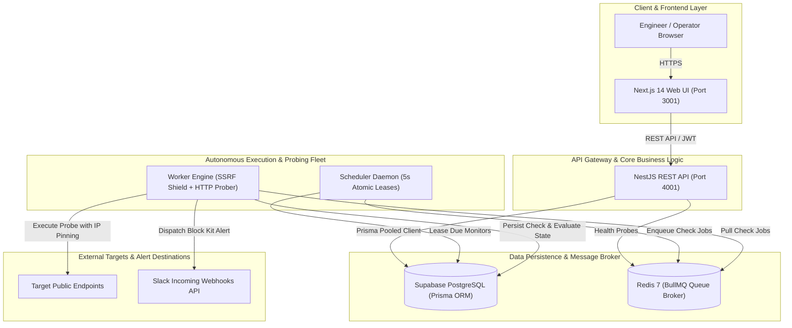
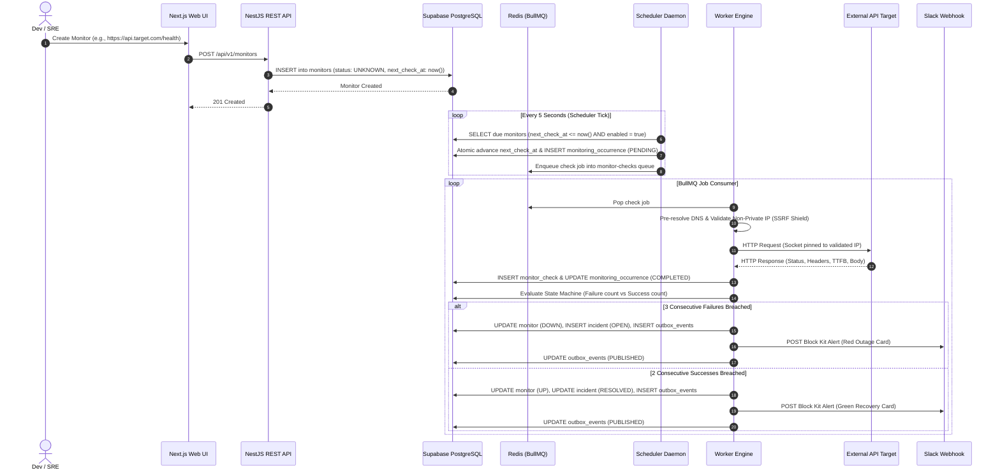
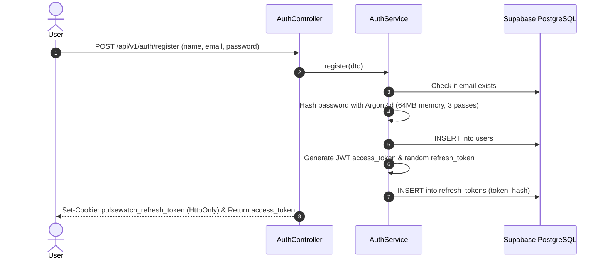
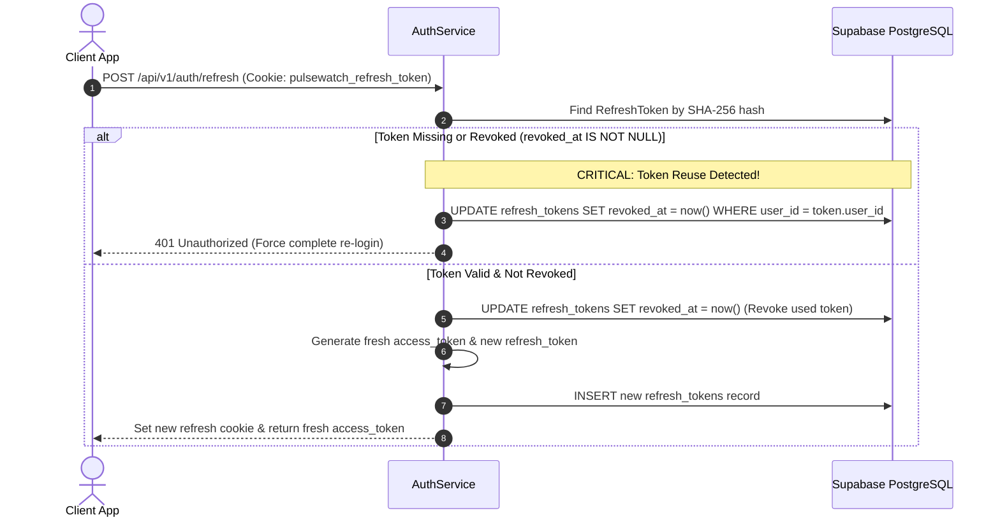
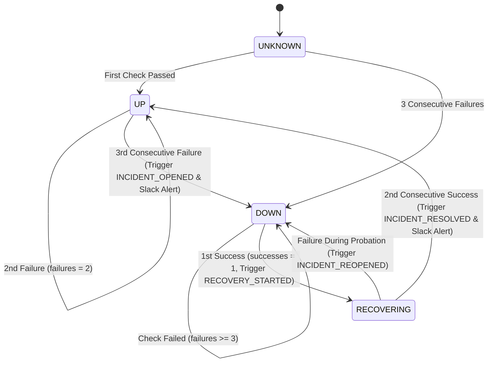

# PulseWatch — System Architecture & Design Specification

**Document:** `docs/Architecture.md`  
**Version:** 1.0.0  
**Status:** Production / Implemented  
**Architecture Style:** Distributed Microservices Monorepo + Asynchronous Event-Driven Processing  
**Repository Tooling:** pnpm Workspaces + Turborepo

---

## 1. System Architecture Overview

PulseWatch is an enterprise-grade API monitoring, uptime verification, and incident management platform. It is engineered to decouple high-frequency scheduling and probe execution from user-facing API interactions.

### 1.1 Core Architecture Highlights
- **Distributed Microservices Topology**: Separates user requests (`apps/api`), web interface (`apps/web`), task scheduling (`apps/scheduler`), and distributed probing (`apps/worker`).
- **Zero-Tolerance SSRF & DNS Rebinding Shield**: Probing engine resolves DNS hostnames before socket connection, blocks private/cloud-metadata IPs (RFC 1918, RFC 4193, `169.254.169.254`), and strictly binds raw sockets to the verified IP to prevent Time-of-Check to Time-of-Use (TOCTOU) DNS rebinding attacks.
- **Microsecond Precision Network Timers**: Employs `process.hrtime.bigint()` to capture network round-trips with sub-millisecond precision.
- **Hysteresis Incident State Machine**: Eliminates alert fatigue and transient false positives via 3-strike failure threshold for outages and 2-strike consecutive success threshold for automated recovery.
- **Transactional Outbox Engine**: Stages alert events (`outbox_events`) atomically with monitor state transitions to guarantee delivery without blocking probe execution.
- **Global Slack Incoming Webhooks**: Delivers structured Block Kit cards to Slack channels for outage and recovery alerts.

---

## 2. High-Level System Architecture Diagram



---

## 3. Technology Stack & Workspace Structure

### 3.1 Technology Matrix
| Layer | Technologies | Purpose |
| :--- | :--- | :--- |
| **Monorepo** | pnpm workspaces, Turborepo | Dependency management and build orchestration. |
| **Frontend** | Next.js 14 (App Router), React 18, Tailwind CSS, Recharts | Interactive dashboard, real-time metrics, incident timelines. |
| **Backend API** | NestJS 10, Express, Passport, class-validator, Argon2id | REST API, tenant isolation, session security, input validation. |
| **Database** | PostgreSQL 15+ (Supabase), Prisma ORM | Relational persistence, connection pooling (PgBouncer port 6543). |
| **Message Queue** | Redis 7, BullMQ | Asynchronous job distribution between scheduler and workers. |
| **Scheduler** | Node.js daemon, Prisma Client | 5-second tick loop, atomic monitor occurrence leasing. |
| **Worker** | Node.js, BullMQ Worker, native `http`/`https` sockets | SSRF defense, socket IP pinning, state machine, Slack alerting. |

### 3.2 Monorepo Directory Organization
```
Api_Monitoring_Platform/
├── apps/
│   ├── api/                  # NestJS 10 REST API microservice
│   │   ├── src/
│   │   │   ├── common/       # Decorators, filters, guards, interceptors
│   │   │   ├── modules/      # Auth, Monitors, Incidents, Dashboard, Health
│   │   │   ├── app.module.ts
│   │   │   └── main.ts
│   ├── scheduler/            # Node.js background scheduler daemon
│   │   └── src/index.ts      # 5-second polling tick loop with atomic leases
│   ├── web/                  # Next.js 14 App Router frontend
│   │   ├── src/app/          # /dashboard, /monitors, /incidents, /login, /register
│   │   └── src/components/   # Recharts charts, tables, navigation, modals
│   └── worker/               # Distributed probe execution worker
│       ├── src/
│       │   ├── executor.ts   # Socket-level prober with SSRF prevention & IP pinning
│       │   ├── incidents.ts  # 3-strike outage / 2-strike recovery state machine
│       │   ├── slack.ts      # Slack Block Kit card builder & webhook dispatcher
│       │   └── index.ts      # BullMQ worker process entry point
├── packages/
│   ├── config/               # Zod-validated environment configuration
│   ├── database/             # Prisma schema, migrations, and database client
│   └── shared/               # Shared TypeScript types, enums, DTOs, and constants
├── docs/                     # Production documentation
│   ├── API_specification.md  # Complete REST API reference
│   ├── Architecture.md       # System architecture and execution flows
│   └── Database.md           # Database models, schemas, and ER diagram
├── docker-compose.prod.yml   # Multi-container production deployment stack
├── package.json              # Monorepo root package configuration
└── turbo.json                # Turborepo task pipeline definition
```

---

## 4. Backend Component Interaction & Data Flow



---

## 5. Core Execution Flows

### 5.1 User Registration & Authentication Lifecycle


### 5.2 Refresh Token Rotation & Reuse Revocation Flow


### 5.3 Monitor Scheduling & Lease Management
1. The **Scheduler daemon** executes every 5 seconds.
2. It queries due monitors using the optimized compound index:
   ```sql
   SELECT * FROM monitors 
   WHERE enabled = true AND next_check_at <= NOW() 
   LIMIT 100;
   ```
3. To prevent duplicate executions, the scheduler advances `next_check_at` immediately inside a transaction:
   ```sql
   UPDATE monitors 
   SET next_check_at = NOW() + (interval_seconds * INTERVAL '1 second')
   WHERE id = $1;
   ```
4. It inserts a `monitoring_occurrences` row with status `PENDING` and a lease expiration (`leaseExpiresAt = now() + 60s`).
5. It pushes the job payload to Redis (`monitor-checks` BullMQ queue).

### 5.4 SSRF Shield & HTTP Probe Execution
The worker execution pipeline follows strict defensive networking:
1. **DNS Pre-Resolution**: Hostname is resolved via `dns.promises.lookup(hostname)`.
2. **Private IP Rejection**: Validates that resolved IPv4/IPv6 addresses do not fall within private or cloud ranges:
   - `10.0.0.0/8`, `172.16.0.0/12`, `192.168.0.0/16` (RFC 1918)
   - `127.0.0.0/8` (Loopback)
   - `169.254.0.0/16` (Link-local / AWS / GCP / Azure metadata endpoint `169.254.169.254`)
   - `::1`, `fc00::/7`, `fe80::/10` (IPv6 loopback, unique local, link-local)
3. **Socket IP Pinning**: The custom `http.Agent` overrides `lookup` to return the pre-verified IP, preventing attackers from modifying DNS records between verification and socket creation (defeating DNS rebinding).
4. **Timing Breakdown**: Microsecond timers track `process.hrtime.bigint()` to log total `responseTimeMs`.

### 5.5 Incident State Machine & Flapping Prevention
PulseWatch employs a deterministic hysteresis state machine:



- **Outage Declaration**: Requires **3 consecutive failures**. Single or double intermittent failures do not create incidents or spam alerts.
- **Probationary Recovery (`RECOVERING`)**: A single success shifts the incident to `RECOVERING`.
- **Flap Regression**: If a check fails while in `RECOVERING`, the state immediately reverts to `DOWN` and logs an `INCIDENT_REOPENED` event.
- **Incident Resolution**: Requires **2 consecutive successes** to transition to `RESOLVED` and reset monitor status to `UP`.

### 5.6 Transactional Outbox Pattern & Slack Integration
To prevent dual-write failure vulnerabilities (where an incident is written to the database but an alert fails to dispatch or crashes the worker):
1. **Atomic Outbox Staging**: On incident status transitions (`INCIDENT_OPENED`, `INCIDENT_RESOLVED`), an `outbox_events` record is written inside the same database transaction as the `incidents` and `monitors` updates.
2. **Immediate In-Process Dispatch**: The worker immediately attempts asynchronous dispatch to `sendSlackAlert` using `SLACK_WEBHOOK_URL`.
3. **Block Kit Formatting**: Outage alerts render with red borders (`#E01E5A`) and failure details. Recovery alerts render with green borders (`#2EB67D`) and duration.
4. **Publication Ack**: Upon receiving HTTP 200 from Slack, the outbox record is marked `PUBLISHED` with `publishedAt = now()`.
5. **Fault Tolerance**: If Slack is unreachable or rate-limits requests, the record remains `PENDING` (or `FAILED`), ready for asynchronous poller retries.
