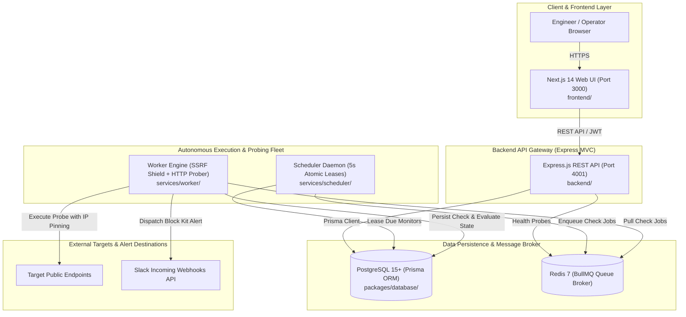
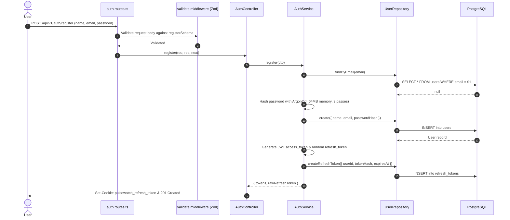

# PulseWatch — System Architecture & Design Specification

**Document:** `docs/Architecture.md`  
**Version:** 2.0.0  
**Status:** Production / Implemented  
**Architecture Style:** Modular Monorepo + Express.js MVC Backend + Next.js App Router Frontend + Distributed Probing Fleet  
**Repository Tooling:** npm Workspaces + Turborepo + Docker Compose

---

## 1. System Architecture Overview

PulseWatch is an API monitoring, uptime verification, and incident management platform. Its monorepo separates the **Next.js frontend**, **Express.js MVC backend**, background scheduling and probe execution services, and shared workspace packages.

### 1.1 Architectural Highlights
- **Layered MVC backend:** Controllers handle HTTP requests, services implement domain logic, and repositories provide database access through Prisma.
- **SSRF and DNS rebinding protection:** Before connecting, the probing engine resolves hostnames, blocks private and cloud metadata addresses (including RFC 1918, RFC 4193, and `169.254.169.254` ranges), and binds raw sockets to the verified IP address. This prevents a DNS response from changing between validation and connection (a TOCTOU attack).
- **High-resolution network timing:** `process.hrtime.bigint()` measures network round trips with sub-millisecond resolution.
- **Incident hysteresis:** An incident opens after three consecutive failures and resolves after two consecutive successes, reducing alerts caused by transient failures.
- **Transactional outbox:** Alert events (`outbox_events`) are staged atomically with monitor state changes so delivery can proceed without blocking probe execution.
- **Slack alerts:** Incoming webhooks deliver structured Block Kit messages for outages and recoveries.

---

## 2. High-Level System Architecture Diagram



---

## 3. Monorepo Directory Organization

```
PulseWatch/
├── frontend/                 # Next.js 14 App Router client application
│   ├── src/
│   │   ├── app/              # Routes: /dashboard, /monitors, /incidents, /login, /register
│   │   ├── components/       # UI components, Recharts visualizations, navigation
│   │   ├── context/          # Client state & AuthProvider
│   │   ├── hooks/            # Custom React hooks
│   │   ├── lib/              # Centralized API client & utilities
│   │   ├── services/         # Frontend API integration services
│   │   └── types/            # Frontend TypeScript types
│   ├── public/               # Static assets & icons
│   ├── Dockerfile            # Multi-stage production container
│   ├── package.json          # Dependencies: @pulsewatch/shared, next, react, recharts
│   └── tsconfig.json
│
├── backend/                  # Express.js REST API with MVC Architecture
│   ├── src/
│   │   ├── config/           # Environment configuration via @pulsewatch/config
│   │   ├── controllers/      # HTTP request/response handlers (Auth, Monitor, Incident, Dashboard, Health)
│   │   ├── services/         # Domain business rules & repository coordination
│   │   ├── repositories/     # Prisma data-access abstraction layer
│   │   ├── models/           # Domain models & entities
│   │   ├── routes/           # Express modular routers (/auth, /monitors, /incidents, /dashboard, /health)
│   │   ├── middlewares/      # JWT auth, Zod validation, error handling, rate limiting, logging
│   │   ├── validators/       # Zod schemas for request validation
│   │   ├── utils/            # JWT helpers, Argon2id, logger, custom error classes, response formatters
│   │   ├── types/            # AuthenticatedRequest and backend types
│   │   ├── app.ts            # Express app configuration & middleware pipeline
│   │   └── server.ts         # Server bootstrap, DB healthcheck, graceful shutdown
│   ├── Dockerfile            # Multi-stage production container
│   ├── package.json          # Dependencies: express, helmet, cors, argon2, jsonwebtoken, zod
│   └── tsconfig.json
│
├── services/                 # Distributed background daemons
│   ├── scheduler/            # 5-second atomic lease scheduling daemon
│   │   ├── src/index.ts      # Lease polling & BullMQ job dispatch
│   │   └── Dockerfile
│   └── worker/               # Distributed probe execution worker
│       ├── src/
│       │   ├── executor.ts   # Raw socket HTTP client with microsecond timing
│       │   ├── ssrf.ts       # SSRF pre-flight DNS validation & IP pinning
│       │   ├── incidents.ts  # 3-strike outage / 2-strike recovery state machine
│       │   ├── slack.ts      # Slack Block Kit notification dispatcher
│       │   └── index.ts      # BullMQ worker consumer
│       └── Dockerfile
│
├── packages/                 # Shared monorepo libraries
│   ├── database/             # Prisma schema, migrations, and shared Prisma client
│   └── shared/               # Shared TypeScript types, enums, DTOs, and response envelopes
│
├── docs/                     # Project documentation specifications
│   ├── API_specification.md  # Complete REST API reference
│   ├── Architecture.md       # Architectural specifications & execution flows
│   └── Database.md           # Database ER diagram & table definitions
├── test/                     # Automated verification suites
│   ├── system-verification.ts# 36-test comprehensive verification harness
│   └── test-slack.ts         # Live Slack incoming webhook test utility
├── .env                      # Local environment configuration
├── .env.example              # Template environment configuration
├── docker-compose.yml        # Full-stack Docker Compose (frontend, backend, postgres, redis, scheduler, worker)
├── package.json              # Monorepo root package configuration
├── package-lock.json         # npm dependency lockfile
└── turbo.json                # Turborepo task pipeline definition
```

---

## 4. Express.js MVC Architecture

The backend uses a layered **Model-View-Controller (MVC)** pattern:

```
[ HTTP Request ]
       |
       v
[ Express Middleware Pipeline ] -> Helmet, CORS, Cookie-Parser, JSON Parser, Logger, Rate-Limiter
       |
       v
[ Route Layer (routes/) ] -------> Matches path, runs Auth & Zod Validation Middlewares
       |
       v
[ Controller Layer (controllers/) ] -> Parses input, calls Service, sends Standard JSON Response
       |
       v
[ Service Layer (services/) ] -------> Executes business rules, orchestrates Repositories, handles crypto/JWT
       |
       v
[ Repository Layer (repositories/) ]-> Encapsulates Prisma queries against PostgreSQL
       |
       v
[ Database (packages/database/) ] ---> Executes SQL queries
```

### 4.1 Controllers
- Handle HTTP requests, extract parameters, body, and query values, invoke services, and format standardized responses (`sendSuccess` / `sendError`).
- Never perform raw database queries or complex calculations.

### 4.2 Services
- Implement business logic such as Argon2id password hashing, JWT signing, refresh-token rotation, IDOR permission checks, and aggregation calculations.

### 4.3 Repositories
- Encapsulate database queries through the shared `@pulsewatch/database` Prisma client.
- Provide clean async methods (`create`, `findById`, `findMany`, `update`, `delete`, `get24hStats`).

---

## 5. Core Execution Flows

### 5.1 User Registration & Authentication Lifecycle


### 5.2 Monitor Scheduling & Probe Execution
1. **Scheduler tick:** The scheduler daemon (`services/scheduler`) polls PostgreSQL every five seconds for enabled monitors whose `nextCheckAt` is due.
2. **Lease advance:** In one database transaction, the scheduler advances `nextCheckAt` by the monitor interval and creates a `PENDING` `monitoring_occurrences` record with a 60-second lease.
3. **Queue dispatch:** The scheduler enqueues a check job in the BullMQ `monitor-checks` queue, backed by Redis.
4. **Probe execution:** A worker in `services/worker` consumes the job, validates DNS to guard against SSRF, pins the raw socket to the verified public IP, and performs the HTTP probe with high-resolution timing.
5. **State update and alerting:** The worker saves the result to `monitor_checks`. After three consecutive failures, it opens an incident and stages an `INCIDENT_OPENED` outbox event for Slack delivery. After two consecutive successes, it resolves the incident and dispatches a recovery alert.
