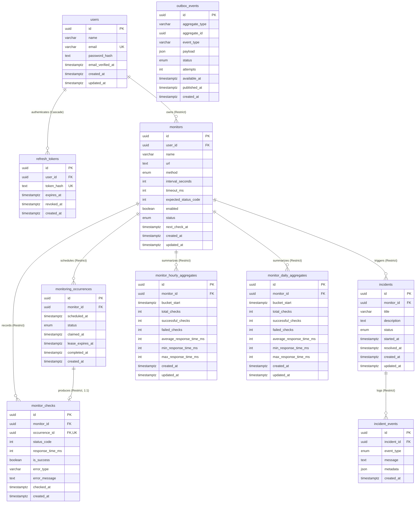

# PulseWatch — Database Design & Schema Specification

**Document:** `docs/Database.md`  
**Version:** 2.1.0  
**Status:** Implemented / Verified against Codebase  
**Database Engine:** PostgreSQL 15+ (Local Docker or Managed Cloud PostgreSQL)  
**Object-Relational Mapping (ORM):** Prisma ORM v5.22.0  
**Package Workspace:** `packages/database`

---

## 1. Database Architecture & Design Principles

PulseWatch relies on PostgreSQL as its primary ACID-compliant relational data store. All core platform state—including tenant accounts, authentication sessions, monitor configurations, discrete scheduled execution occurrences, probe check logs, outage incidents, incident audit event timelines, hourly/daily pre-aggregated metric rollups, and transactional outbox events—is persisted and indexed in PostgreSQL.

### 1.1 Express MVC Repository Layer Integration
Direct database access and Prisma Client invocations are strictly forbidden in HTTP controllers, middleware, and route handlers. Data access is encapsulated within dedicated repository classes in `backend/src/repositories/`:
- **`UserRepository` (`user.repository.ts`)**: Tenant registration, credential retrieval, email verification, HMAC-SHA256 refresh token persistence, atomic token rotation, and single-query user-wide session revocations.
- **`MonitorRepository` (`monitor.repository.ts`)**: Monitor lifecycle, scheduler due-check polling, atomic cascading deletions (`prisma.$transaction`), paginated check queries, and 24-hour groupBy metrics aggregation.
- **`IncidentRepository` (`incident.repository.ts`)**: Outage record creation, incident timeline event logging, status transitions (`OPEN`, `RECOVERING`, `RESOLVED`), and paginated incident listing.
- **`DashboardRepository` (`dashboard.repository.ts`)**: Parallel aggregate count queries (total monitors, UP, DOWN, PAUSED status counts, open incidents, and 24-hour average latency).

### 1.2 Referential Integrity & Deletion Strategy
The database schema intentionally enforces **`onDelete: Restrict`** on all core relational constraints (except refresh tokens) to prevent accidental cascading data loss. When a monitor is removed, `MonitorRepository.delete(id)` coordinates an explicit, ordered database transaction (`prisma.$transaction`) that systematically purges dependent records (`incident_events`, `incidents`, `monitor_checks`, `monitoring_occurrences`, and aggregates) before deleting the root monitor row. Conversely, `refresh_tokens` use database-level **`onDelete: Cascade`** tied to `users(id)` so account deletion immediately invalidates all active sessions.

---

## 2. Complete Entity-Relationship (ER) Diagram



---

## 3. PostgreSQL Enums

The schema registers six custom PostgreSQL ENUM types defined in `packages/database/prisma/schema.prisma`:

| Enum Name | Defined Values | Usage Description |
| :--- | :--- | :--- |
| **`MonitorStatus`** | `UNKNOWN`, `UP`, `DOWN`, `PAUSED` | Operational health state of a monitor. Defaults to `UNKNOWN`. |
| **`MonitorMethod`** | `GET`, `HEAD` | Supported HTTP probing verbs. Defaults to `GET`. |
| **`OccurrenceStatus`** | `PENDING`, `QUEUED`, `PROCESSING`, `COMPLETED`, `SKIPPED`, `FAILED` | Lifecycle state of a scheduled execution occurrence slot. Defaults to `PENDING`. |
| **`IncidentStatus`** | `OPEN`, `RECOVERING`, `RESOLVED` | Outage lifecycle state tracked by the worker incident hysteresis engine. Defaults to `OPEN`. |
| **`IncidentEventType`** | `INCIDENT_OPENED`, `RECOVERY_STARTED`, `INCIDENT_REOPENED`, `INCIDENT_RESOLVED` | State transition audit log event recorded in `incident_events`. |
| **`OutboxStatus`** | `PENDING`, `PROCESSING`, `PUBLISHED`, `FAILED` | Delivery state for transactional outbox notifications. Defaults to `PENDING`. |

---

## 4. Comprehensive Table Specifications

### 4.1 `users`
Persists tenant operator identity and Argon2id password hashes.

- **Prisma Model:** `User`
- **PostgreSQL Table:** `users`

| Column | Prisma Field | Type | Nullable | Default | Description |
| :--- | :--- | :--- | :--- | :--- | :--- |
| `id` | `id` | `UUID` (`@db.Uuid`) | No | `uuid()` | Primary Key. |
| `name` | `name` | `VARCHAR(100)` | No | — | User's display name. |
| `email` | `email` | `VARCHAR(255)` | No | — | Unique login email address. |
| `password_hash` | `passwordHash` | `TEXT` | No | — | Argon2id cryptographic password hash. |
| `email_verified_at`| `emailVerifiedAt`| `TIMESTAMPTZ(6)`| Yes | `null` | Timestamp when email was verified. |
| `created_at` | `createdAt` | `TIMESTAMPTZ(6)`| No | `now()` | Row creation timestamp. |
| `updated_at` | `updatedAt` | `TIMESTAMPTZ(6)`| No | Auto (`@updatedAt`) | Row update timestamp. |

- **Primary Key:** `id`
- **Unique Constraints:** `email`
- **Relations:**
  - `monitors`: One-to-many relation (`Monitor[]`) with `onDelete: Restrict`.
  - `refreshTokens`: One-to-many relation (`RefreshToken[]`) with `onDelete: Cascade`.

---

### 4.2 `refresh_tokens`
Stores HMAC-SHA256 hashes of issued refresh tokens to enable secure session rotation and detect reuse.

- **Prisma Model:** `RefreshToken`
- **PostgreSQL Table:** `refresh_tokens`

| Column | Prisma Field | Type | Nullable | Default | Description |
| :--- | :--- | :--- | :--- | :--- | :--- |
| `id` | `id` | `UUID` (`@db.Uuid`) | No | `uuid()` | Primary Key. |
| `user_id` | `userId` | `UUID` (`@db.Uuid`) | No | — | Foreign Key referencing `users(id)`. |
| `token_hash` | `tokenHash` | `TEXT` (`@db.Text`) | No | — | Unique HMAC-SHA256 digest of the refresh token. |
| `expires_at` | `expiresAt` | `TIMESTAMPTZ(6)`| No | — | Expiration timestamp (typically 30 days from issuance). |
| `revoked_at` | `revokedAt` | `TIMESTAMPTZ(6)`| Yes | `null` | Timestamp when explicitly invalidated or rotated. |
| `created_at` | `createdAt` | `TIMESTAMPTZ(6)`| No | `now()` | Token creation timestamp. |

- **Primary Key:** `id`
- **Foreign Keys:** `user_id` -> `users(id)` ON DELETE CASCADE
- **Unique Constraints:** `token_hash`
- **Indexes:**
  - `@@index([userId])`: Fast session lookup by user.
  - `@@index([expiresAt])`: Efficient batch cleanup of expired tokens.

---

### 4.3 `monitors`
Defines HTTP probe target configurations, execution cadences, expected response status codes, and current health status.

- **Prisma Model:** `Monitor`
- **PostgreSQL Table:** `monitors`

| Column | Prisma Field | Type | Nullable | Default | Description |
| :--- | :--- | :--- | :--- | :--- | :--- |
| `id` | `id` | `UUID` (`@db.Uuid`) | No | `uuid()` | Primary Key. |
| `user_id` | `userId` | `UUID` (`@db.Uuid`) | No | — | Foreign Key referencing `users(id)`. |
| `name` | `name` | `VARCHAR(100)` | No | — | User-defined monitor label. |
| `url` | `url` | `TEXT` (`@db.Text`) | No | — | Target URL to monitor. |
| `method` | `method` | `MonitorMethod` | No | `GET` | HTTP probe method (`GET` or `HEAD`). |
| `interval_seconds` | `intervalSeconds` | `INT` | No | `60` | Check interval in seconds (minimum 10s). |
| `timeout_ms` | `timeoutMs` | `INT` | No | `10000` | HTTP request timeout in milliseconds. |
| `expected_status_code` | `expectedStatusCode` | `INT` | No | `200` | Target HTTP status code considered successful. |
| `enabled` | `enabled` | `BOOLEAN` | No | `true` | Active polling toggle. |
| `status` | `status` | `MonitorStatus` | No | `UNKNOWN` | Current health state (`UNKNOWN`, `UP`, `DOWN`, `PAUSED`). |
| `next_check_at` | `nextCheckAt` | `TIMESTAMPTZ(6)`| Yes | `null` | Timestamp when the next probe execution is due. |
| `created_at` | `createdAt` | `TIMESTAMPTZ(6)`| No | `now()` | Row creation timestamp. |
| `updated_at` | `updatedAt` | `TIMESTAMPTZ(6)`| No | Auto (`@updatedAt`) | Row update timestamp. |

- **Primary Key:** `id`
- **Foreign Keys:** `user_id` -> `users(id)` ON DELETE RESTRICT
- **Indexes:**
  - `@@index([userId])`: Fast filtering of monitors by owning user.
  - `@@index([userId, createdAt])`: Efficient dashboard pagination by tenant.
  - `@@index([nextCheckAt], map: "idx_monitors_next_check_at")`: Critical hot-path index for the scheduler poll loop (`findDueMonitors`).
- **Relations:**
  - `user`: References `users(id)` (`onDelete: Restrict`).
  - `checks`: One-to-many relation (`MonitorCheck[]`).
  - `occurrences`: One-to-many relation (`MonitoringOccurrence[]`).
  - `incidents`: One-to-many relation (`Incident[]`).
  - `hourly`: One-to-many relation (`MonitorHourlyAggregate[]`).
  - `daily`: One-to-many relation (`MonitorDailyAggregate[]`).

---

### 4.4 `monitoring_occurrences`
Represents discrete scheduled execution slots for monitor checks. Implements distributed lease locking to coordinate probe worker concurrency and prevent duplicate executions.

- **Prisma Model:** `MonitoringOccurrence`
- **PostgreSQL Table:** `monitoring_occurrences`

| Column | Prisma Field | Type | Nullable | Default | Description |
| :--- | :--- | :--- | :--- | :--- | :--- |
| `id` | `id` | `UUID` (`@db.Uuid`) | No | `uuid()` | Primary Key. |
| `monitor_id` | `monitorId` | `UUID` (`@db.Uuid`) | No | — | Foreign Key referencing `monitors(id)`. |
| `scheduled_at` | `scheduledAt` | `TIMESTAMPTZ(6)`| No | — | The nominal timestamp when the check was scheduled. |
| `status` | `status` | `OccurrenceStatus`| No | `PENDING` | Current state (`PENDING`, `QUEUED`, `PROCESSING`, `COMPLETED`, `SKIPPED`, `FAILED`). |
| `claimed_at` | `claimedAt` | `TIMESTAMPTZ(6)`| Yes | `null` | Timestamp when a worker claimed the occurrence lease. |
| `lease_expires_at`| `leaseExpiresAt`| `TIMESTAMPTZ(6)`| Yes | `null` | Lease timeout timestamp (used for stuck job reclamation). |
| `completed_at` | `completedAt` | `TIMESTAMPTZ(6)`| Yes | `null` | Timestamp when probe execution finished. |
| `created_at` | `createdAt` | `TIMESTAMPTZ(6)`| No | `now()` | Row creation timestamp. |

- **Primary Key:** `id`
- **Foreign Keys:** `monitor_id` -> `monitors(id)` ON DELETE RESTRICT
- **Unique Constraints:** `@@unique([monitorId, scheduledAt])` (Prevents duplicate occurrence scheduling for the same monitor tick).
- **Indexes:**
  - `@@index([status, createdAt])`: Efficient polling for pending or queued occurrences.
  - `@@index([leaseExpiresAt])`: Fast queries to reclaim abandoned or timed-out worker leases.
  - `@@index([monitorId, scheduledAt(sort: Desc)])`: Optimized historical timeline sorting.
- **Relations:**
  - `monitor`: References `monitors(id)` (`onDelete: Restrict`).
  - `check`: One-to-one back-relation (`MonitorCheck?`).

---

### 4.5 `monitor_checks`
Raw execution telemetry, HTTP status codes, latency timings, and failure reasons logged for every completed probe.

- **Prisma Model:** `MonitorCheck`
- **PostgreSQL Table:** `monitor_checks`

| Column | Prisma Field | Type | Nullable | Default | Description |
| :--- | :--- | :--- | :--- | :--- | :--- |
| `id` | `id` | `UUID` (`@db.Uuid`) | No | `uuid()` | Primary Key. |
| `monitor_id` | `monitorId` | `UUID` (`@db.Uuid`) | No | — | Foreign Key referencing `monitors(id)`. |
| `occurrence_id` | `occurrenceId` | `UUID` (`@db.Uuid`) | No | — | Foreign Key referencing `monitoring_occurrences(id)` (Unique, 1:1). |
| `status_code` | `statusCode` | `INT` | Yes | `null` | Actual HTTP response status code (null on network error). |
| `response_time_ms`| `responseTimeMs`| `INT` | Yes | `null` | Round-trip network response latency in milliseconds. |
| `is_success` | `isSuccess` | `BOOLEAN` | No | — | `true` if `statusCode === expectedStatusCode`, else `false`. |
| `error_type` | `errorType` | `VARCHAR(50)` | Yes | `null` | Categorized error code (e.g. `SSRF_BLOCKED`, `ETIMEDOUT`, `HTTP_STATUS_MISMATCH`). |
| `error_message` | `errorMessage` | `TEXT` (`@db.Text`) | Yes | `null` | Detailed diagnostic error text or exception message. |
| `checked_at` | `checkedAt` | `TIMESTAMPTZ(6)`| No | — | Exact execution timestamp when probe completed. |
| `created_at` | `createdAt` | `TIMESTAMPTZ(6)`| No | `now()` | Row insertion timestamp. |

- **Primary Key:** `id`
- **Foreign Keys:**
  - `monitor_id` -> `monitors(id)` ON DELETE RESTRICT
  - `occurrence_id` -> `monitoring_occurrences(id)` ON DELETE RESTRICT
- **Unique Constraints:** `occurrence_id` (Guarantees at most one check record per occurrence).
- **Indexes:**
  - `@@index([monitorId, checkedAt(sort: Desc)])`: Primary index for monitor recent check history (`getRecentChecks`).
  - `@@index([monitorId, isSuccess, checkedAt(sort: Desc)])`: Filtered index for incident and success rate queries.
  - `@@index([checkedAt])`: Global time-range index for analytics rollups and data pruning.
- **Relations:**
  - `monitor`: References `monitors(id)` (`onDelete: Restrict`).
  - `occurrence`: References `monitoring_occurrences(id)` (`onDelete: Restrict`).

---

### 4.6 `incidents`
Tracks service downtime periods and outages triggered by the worker's incident hysteresis engine.

- **Prisma Model:** `Incident`
- **PostgreSQL Table:** `incidents`

| Column | Prisma Field | Type | Nullable | Default | Description |
| :--- | :--- | :--- | :--- | :--- | :--- |
| `id` | `id` | `UUID` (`@db.Uuid`) | No | `uuid()` | Primary Key. |
| `monitor_id` | `monitorId` | `UUID` (`@db.Uuid`) | No | — | Foreign Key referencing `monitors(id)`. |
| `title` | `title` | `VARCHAR(255)` | No | — | Incident summary headline (e.g. `Monitor <name> is DOWN`). |
| `description` | `description` | `TEXT` (`@db.Text`) | Yes | `null` | Detailed description of the outage and failure context. |
| `status` | `status` | `IncidentStatus`| No | `OPEN` | Current incident status (`OPEN`, `RECOVERING`, `RESOLVED`). |
| `started_at` | `startedAt` | `TIMESTAMPTZ(6)`| No | `now()` | Timestamp when outage was confirmed (after $N$ consecutive failures). |
| `resolved_at` | `resolvedAt` | `TIMESTAMPTZ(6)`| Yes | `null` | Timestamp when monitor recovered (after $M$ consecutive successes). |
| `created_at` | `createdAt` | `TIMESTAMPTZ(6)`| No | `now()` | Row creation timestamp. |
| `updated_at` | `updatedAt` | `TIMESTAMPTZ(6)`| No | Auto (`@updatedAt`) | Row update timestamp. |

- **Primary Key:** `id`
- **Foreign Keys:** `monitor_id` -> `monitors(id)` ON DELETE RESTRICT
- **Indexes:**
  - `@@index([monitorId, startedAt(sort: Desc)])`: Fast query of incident history per monitor.
  - `@@index([status, startedAt(sort: Desc)])`: Query open/recovering incidents across the system.
- **Relations:**
  - `monitor`: References `monitors(id)` (`onDelete: Restrict`).
  - `events`: One-to-many relation (`IncidentEvent[]`).

---

### 4.7 `incident_events`
Audit trail recording every state transition, failure escalation, or recovery step during an incident's lifecycle.

- **Prisma Model:** `IncidentEvent`
- **PostgreSQL Table:** `incident_events`

| Column | Prisma Field | Type | Nullable | Default | Description |
| :--- | :--- | :--- | :--- | :--- | :--- |
| `id` | `id` | `UUID` (`@db.Uuid`) | No | `uuid()` | Primary Key. |
| `incident_id` | `incidentId` | `UUID` (`@db.Uuid`) | No | — | Foreign Key referencing `incidents(id)`. |
| `event_type` | `eventType` | `IncidentEventType`| No | — | Event type (`INCIDENT_OPENED`, `RECOVERY_STARTED`, `INCIDENT_REOPENED`, `INCIDENT_RESOLVED`). |
| `message` | `message` | `TEXT` (`@db.Text`) | No | — | Human-readable explanation of the state change. |
| `metadata` | `metadata` | `JSON` (`Json?`) | Yes | `null` | Additional structured JSON payload (status code, error details, consecutive counts). |
| `created_at` | `createdAt` | `TIMESTAMPTZ(6)`| No | `now()` | Row creation timestamp. |

- **Primary Key:** `id`
- **Foreign Keys:** `incident_id` -> `incidents(id)` ON DELETE RESTRICT
- **Indexes:**
  - `@@index([incidentId, createdAt])`: Efficient timeline retrieval in ascending or descending sequence.
- **Relations:**
  - `incident`: References `incidents(id)` (`onDelete: Restrict`).

---

### 4.8 `monitor_hourly_aggregates` & `monitor_daily_aggregates`
Pre-aggregated rollups calculated over one-hour and one-day intervals. Powers long-range dashboard charts without running expensive aggregate calculations over millions of raw check rows.

- **Prisma Models:** `MonitorHourlyAggregate`, `MonitorDailyAggregate`
- **PostgreSQL Tables:** `monitor_hourly_aggregates`, `monitor_daily_aggregates`

| Column | Prisma Field | Type | Nullable | Default | Description |
| :--- | :--- | :--- | :--- | :--- | :--- |
| `id` | `id` | `UUID` (`@db.Uuid`) | No | `uuid()` | Primary Key. |
| `monitor_id` | `monitorId` | `UUID` (`@db.Uuid`) | No | — | Foreign Key referencing `monitors(id)`. |
| `bucket_start` | `bucketStart` | `TIMESTAMPTZ(6)`| No | — | Start timestamp of the aggregation bucket window. |
| `total_checks` | `totalChecks` | `INT` | No | `0` | Total checks executed within this time bucket. |
| `successful_checks`| `successfulChecks`| `INT` | No | `0` | Successful checks within this time bucket. |
| `failed_checks` | `failedChecks` | `INT` | No | `0` | Failed checks within this time bucket. |
| `average_response_time_ms`| `averageResponseTimeMs`| `INT` | Yes | `null` | Average round-trip latency in milliseconds. |
| `min_response_time_ms`| `minResponseTimeMs`| `INT` | Yes | `null` | Minimum round-trip latency in milliseconds. |
| `max_response_time_ms`| `maxResponseTimeMs`| `INT` | Yes | `null` | Maximum round-trip latency in milliseconds. |
| `created_at` | `createdAt` | `TIMESTAMPTZ(6)`| No | `now()` | Row creation timestamp. |
| `updated_at` | `updatedAt` | `TIMESTAMPTZ(6)`| No | Auto (`@updatedAt`) | Row update timestamp. |

- **Primary Key:** `id`
- **Foreign Keys:** `monitor_id` -> `monitors(id)` ON DELETE RESTRICT
- **Unique Constraints:** `@@unique([monitorId, bucketStart])` (One aggregate row per monitor per time window).
- **Indexes:**
  - `@@index([monitorId, bucketStart(sort: Desc)])`: Accelerated time-range chart loading.
- **Relations:**
  - `monitor`: References `monitors(id)` (`onDelete: Restrict`).

---

### 4.9 `outbox_events`
Implements the Transactional Outbox pattern. Guarantees that external notification events (such as Slack alerts) are written to the database atomically within the incident state transition transaction before delivery is attempted.

- **Prisma Model:** `OutboxEvent`
- **PostgreSQL Table:** `outbox_events`

| Column | Prisma Field | Type | Nullable | Default | Description |
| :--- | :--- | :--- | :--- | :--- | :--- |
| `id` | `id` | `UUID` (`@db.Uuid`) | No | `uuid()` | Primary Key. |
| `aggregate_type` | `aggregateType`| `VARCHAR(100)` | No | — | Type of entity producing the event (e.g. `Incident`). |
| `aggregate_id` | `aggregateId` | `UUID` (`@db.Uuid`) | No | — | Identifier of the entity (e.g. `incidentId`). |
| `event_type` | `eventType` | `VARCHAR(100)` | No | — | Event name (e.g. `INCIDENT_OPENED`, `INCIDENT_RESOLVED`). |
| `payload` | `payload` | `JSON` (`Json`) | No | — | Complete JSON payload required for alert dispatch. |
| `status` | `status` | `OutboxStatus` | No | `PENDING` | Delivery status (`PENDING`, `PROCESSING`, `PUBLISHED`, `FAILED`). |
| `attempts` | `attempts` | `INT` | No | `0` | Number of delivery retry attempts. |
| `available_at` | `availableAt` | `TIMESTAMPTZ(6)`| No | `now()` | Timestamp after which the message can be processed. |
| `published_at` | `publishedAt` | `TIMESTAMPTZ(6)`| Yes | `null` | Timestamp when notification was successfully delivered. |
| `created_at` | `createdAt` | `TIMESTAMPTZ(6)`| No | `now()` | Row creation timestamp. |

- **Primary Key:** `id`
- **Foreign Keys:** None (Intentionally decoupled from domain tables to isolate outbox lifecycle from domain entity deletions).
- **Indexes:**
  - `@@index([status, availableAt])`: Highly optimized query for outbox publishers polling for pending messages.
  - `@@index([aggregateType, aggregateId])`: Fast lookup of all outbox events associated with a specific entity.

---

## 5. Critical Database Flows & Design Choices

### 5.1 Controlled Cascading Deletion Transaction
Because Prisma models configure `onDelete: Restrict`, deleting a `Monitor` directly via a standard SQL `DELETE FROM monitors WHERE id = ?` fails if dependent checks, incidents, or occurrences exist. `MonitorRepository.delete(id)` in `backend/src/repositories/monitor.repository.ts` manages this through an atomic `prisma.$transaction`:

```typescript
await this.prisma.$transaction(async (tx) => {
  // 1. Find all incident IDs linked to this monitor
  const incidents = await tx.incident.findMany({
    where: { monitorId: id },
    select: { id: true },
  });
  const incidentIds = incidents.map((i) => i.id);

  // 2. Delete incident events for those incidents
  if (incidentIds.length > 0) {
    await tx.incidentEvent.deleteMany({
      where: { incidentId: { in: incidentIds } },
    });
  }

  // 3. Delete incidents
  await tx.incident.deleteMany({ where: { monitorId: id } });

  // 4. Delete raw checks
  await tx.monitorCheck.deleteMany({ where: { monitorId: id } });

  // 5. Delete occurrences
  await tx.monitoringOccurrence.deleteMany({ where: { monitorId: id } });

  // 6. Delete hourly and daily aggregates
  await tx.monitorHourlyAggregate.deleteMany({ where: { monitorId: id } });
  await tx.monitorDailyAggregate.deleteMany({ where: { monitorId: id } });

  // 7. Delete the parent monitor record
  return tx.monitor.delete({ where: { id } });
});
```

### 5.2 Refresh Token Hashing & Reuse Invalidation
To mitigate database compromise risks, raw refresh tokens are never stored in plaintext:
1. When issued, the raw 64-byte hex string is transmitted exclusively to the client in an `HttpOnly` cookie.
2. An HMAC-SHA256 digest is generated via `crypto.createHmac('sha256', env.JWT_REFRESH_SECRET).update(token).digest('hex')` and saved in `refresh_tokens.token_hash`.
3. During rotation (`POST /api/v1/auth/refresh`), if a token with `revoked_at !== null` is presented, the system recognizes a token reuse attack and immediately invokes `UserRepository.revokeAllUserRefreshTokens(userId)` to invalidate all active sessions for that user.

### 5.3 Distributed Scheduler Concurrency & Duplicate Prevention
To guarantee that monitors are probed accurately without duplicate checks:
1. **Hot-Path Indexing:** `monitors.next_check_at` has an explicit index (`idx_monitors_next_check_at`) enabling the scheduler loop to quickly fetch due monitors (`WHERE enabled = true AND (next_check_at IS NULL OR next_check_at <= NOW())`).
2. **Occurrence Deduplication:** `monitoring_occurrences` enforces a unique constraint on `(monitor_id, scheduled_at)`. If two scheduler loops or instances simultaneously attempt to schedule the same time tick for a monitor, the database rejects the second write.
3. **Lease Expiry Tracking:** The `lease_expires_at` column enables detection and reclamation of stalled worker jobs if a probe worker crashes mid-execution.

### 5.4 24-Hour Metrics GroupBy Aggregations
For the monitor detail view (`GET /api/v1/monitors/:id/metrics`), `MonitorRepository.get24HourMetrics` performs high-performance database-level calculations:
- Queries `monitor_checks` where `monitorId = id` and `checkedAt >= twentyFourHoursAgo`.
- Calculates total checks, total successful checks, overall uptime percentage, average response latency, and p95 latency.
- Executes `prisma.monitorCheck.groupBy({ by: ['statusCode'], where: { ... }, _count: { statusCode: true } })` to provide status code distributions.

---

## 6. Database Migrations & Pruned Schemas

### 6.1 Migration History
The project maintains Prisma migrations under `packages/database/prisma/migrations/`:
- **`20261120_remove_notification_worker_schema`**: Systematically dropped legacy, orphaned notification tables (`notification_channels`, `notification_deliveries`) and enums (`NotificationStatus`, `NotificationType`) following the retirement of the standalone notification-worker service. All alerting is now handled via direct Slack webhooks and `outbox_events`.

### 6.2 Prisma Management Commands
To manage the schema across environments:
- **Generate Prisma Client:**
  ```bash
  npm run db:generate
  # Executes: prisma generate --schema=packages/database/prisma/schema.prisma
  ```
- **Synchronize Schema to Database:**
  ```bash
  npx prisma db push --schema=packages/database/prisma/schema.prisma
  ```
- **Inspect Database with Prisma Studio:**
  ```bash
  npx prisma studio --schema=packages/database/prisma/schema.prisma
  ```
