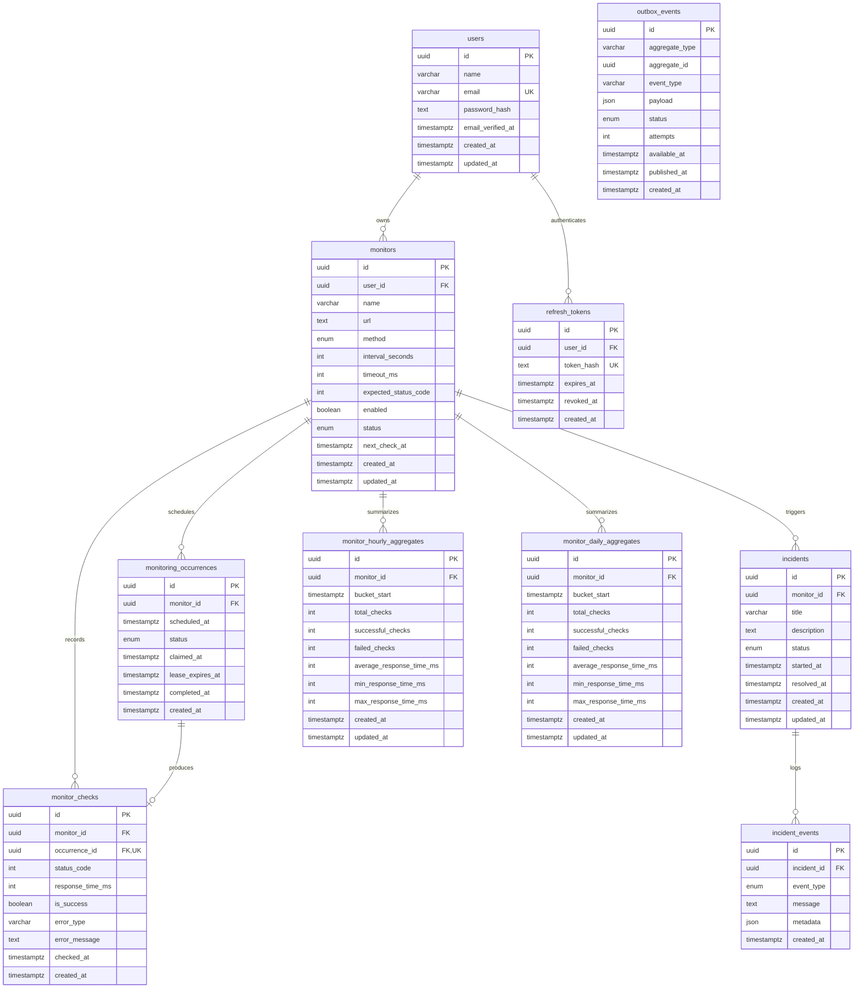

# PulseWatch — Database Design & Schema Specification

**Document:** `docs/Database.md`  
**Version:** 1.0.0  
**Status:** Production / Implemented  
**Database System:** Supabase Managed PostgreSQL (PostgreSQL 15+)  
**Object-Relational Mapping (ORM):** Prisma ORM v5.10.2  
**Schema Path:** `packages/database/prisma/schema.prisma`

---

## 1. Database Overview & Design Principles

PulseWatch uses PostgreSQL as its primary relational store of truth. All application data—including user accounts, monitor definitions, execution logs, incidents, performance aggregates, and transactional outbox events—is persisted in PostgreSQL.

### 1.1 Connection Strategy
PulseWatch leverages Supabase dual-connection configurations:
- **Application Pooler (`DATABASE_URL`)**: Port `6543` utilizing PgBouncer in transaction pooling mode. This allows hundreds of concurrent API, scheduler, and worker connections without exhausting PostgreSQL backend connection limits.
- **Direct Connection (`DIRECT_URL`)**: Port `5432` connecting directly to PostgreSQL for administrative schema migrations (`prisma db push` and `prisma migrate`).

### 1.2 Design Principles
1. **Strict Relational Integrity**: All child entities maintain explicit foreign key constraints.
2. **UUID Primary Keys**: All tables use UUID v4 (`@default(uuid()) @db.Uuid`) primary keys.
3. **UTC Timestamps**: All timestamp columns are stored with time zone support (`TIMESTAMPTZ(6)`).
4. **Targeted Compound Indexing**: Compound indexes support hot query paths (e.g. `(enabled, next_check_at)` for scheduler ticks and `(monitor_id, checked_at DESC)` for sparkline charts).
5. **No Orphaned Schemas**: Obsolete notification delivery and channel tables have been completely removed.

---

## 2. Complete Entity-Relationship (ER) Diagram



---

## 3. Custom Database Enums

| Enum Name | Allowed Values | Description |
| :--- | :--- | :--- |
| **`MonitorStatus`** | `UNKNOWN`, `UP`, `DOWN`, `PAUSED` | Current health status of a monitored endpoint. |
| **`MonitorMethod`** | `GET`, `HEAD` | Supported HTTP probing methods. |
| **`OccurrenceStatus`** | `PENDING`, `QUEUED`, `PROCESSING`, `COMPLETED`, `SKIPPED`, `FAILED` | State of a scheduled execution occurrence. |
| **`IncidentStatus`** | `OPEN`, `RECOVERING`, `RESOLVED` | Lifecycle state of an outage incident. |
| **`IncidentEventType`** | `INCIDENT_OPENED`, `RECOVERY_STARTED`, `INCIDENT_REOPENED`, `INCIDENT_RESOLVED` | Audit trail events for incident transitions. |
| **`OutboxStatus`** | `PENDING`, `PROCESSING`, `PUBLISHED`, `FAILED` | Transactional outbox event delivery status. |

---

## 4. Comprehensive Table Specifications

### 4.1 `users`
Stores registered tenant accounts, credentials, and verification status.

| Column | Type | Nullable | Default | Constraints / Description |
| :--- | :--- | :--- | :--- | :--- |
| `id` | `UUID` | No | `uuid()` | Primary Key. |
| `name` | `VARCHAR(100)` | No | - | Full name of the user. |
| `email` | `VARCHAR(255)` | No | - | Unique login email. |
| `password_hash` | `TEXT` | No | - | Argon2id cryptographically hashed password. |
| `email_verified_at` | `TIMESTAMPTZ(6)`| Yes | `NULL` | Timestamp of email verification. |
| `created_at` | `TIMESTAMPTZ(6)`| No | `now()` | Record creation timestamp. |
| `updated_at` | `TIMESTAMPTZ(6)`| No | Auto | Record modification timestamp. |

- **Indexes**: `users_email_key` (UNIQUE `email`).
- **Relationships**:
  - `monitors`: One-to-Many (`onDelete: Restrict`).
  - `refresh_tokens`: One-to-Many (`onDelete: Cascade`).

---

### 4.2 `refresh_tokens`
Stores hashed refresh tokens to enable token rotation and reuse detection.

| Column | Type | Nullable | Default | Constraints / Description |
| :--- | :--- | :--- | :--- | :--- |
| `id` | `UUID` | No | `uuid()` | Primary Key. |
| `user_id` | `UUID` | No | - | Foreign Key -> `users(id)`. |
| `token_hash` | `TEXT` | No | - | Unique SHA-256 hash of plaintext refresh token. |
| `expires_at` | `TIMESTAMPTZ(6)`| No | - | Expiration timestamp (7 days from issue). |
| `revoked_at` | `TIMESTAMPTZ(6)`| Yes | `NULL` | Revocation timestamp if consumed or revoked. |
| `created_at` | `TIMESTAMPTZ(6)`| No | `now()` | Record creation timestamp. |

- **Indexes**: `refresh_tokens_token_hash_key` (UNIQUE `token_hash`), `refresh_tokens_user_id_idx`, `refresh_tokens_expires_at_idx`.
- **Relationships**: Belongs to `users` (`onDelete: Cascade`).

---

### 4.3 `monitors`
Contains configuration parameters, thresholds, and operational states for monitored endpoints.

| Column | Type | Nullable | Default | Constraints / Description |
| :--- | :--- | :--- | :--- | :--- |
| `id` | `UUID` | No | `uuid()` | Primary Key. |
| `user_id` | `UUID` | No | - | Foreign Key -> `users(id)`. |
| `name` | `VARCHAR(100)` | No | - | Descriptive label for monitor. |
| `url` | `TEXT` | No | - | Target endpoint URL. |
| `method` | `MonitorMethod` | No | `GET` | HTTP probe method (`GET` or `HEAD`). |
| `interval_seconds` | `INT` | No | `60` | Polling frequency in seconds (10 to 86400). |
| `timeout_ms` | `INT` | No | `10000` | Socket connection timeout in milliseconds. |
| `expected_status_code` | `INT` | No | `200` | Expected HTTP status code (100 to 599). |
| `enabled` | `BOOLEAN` | No | `true` | Scheduling toggle. |
| `status` | `MonitorStatus` | No | `UNKNOWN` | Current health status (`UNKNOWN`, `UP`, `DOWN`, `PAUSED`). |
| `next_check_at` | `TIMESTAMPTZ(6)`| Yes | `NULL` | Scheduled timestamp for next execution. |
| `created_at` | `TIMESTAMPTZ(6)`| No | `now()` | Record creation timestamp. |
| `updated_at` | `TIMESTAMPTZ(6)`| No | Auto | Record modification timestamp. |

- **Indexes**: `monitors_user_id_idx`, `monitors_user_id_created_at_idx`, `idx_monitors_next_check_at` (`next_check_at`).
- **Relationships**:
  - Belongs to `users` (`onDelete: Restrict`).
  - Has Many: `checks`, `occurrences`, `incidents`, `hourly`, `daily`.

---

### 4.4 `monitoring_occurrences`
Tracks discrete scheduling slots and distributed lease locks for checks.

| Column | Type | Nullable | Default | Constraints / Description |
| :--- | :--- | :--- | :--- | :--- |
| `id` | `UUID` | No | `uuid()` | Primary Key. |
| `monitor_id` | `UUID` | No | - | Foreign Key -> `monitors(id)`. |
| `scheduled_at` | `TIMESTAMPTZ(6)`| No | - | Scheduled execution slot. |
| `status` | `OccurrenceStatus`| No | `PENDING` | State (`PENDING`, `QUEUED`, `PROCESSING`, `COMPLETED`, `SKIPPED`, `FAILED`). |
| `claimed_at` | `TIMESTAMPTZ(6)`| Yes | `NULL` | Timestamp worker claimed the occurrence. |
| `lease_expires_at`| `TIMESTAMPTZ(6)`| Yes | `NULL` | Worker lease expiration timestamp. |
| `completed_at` | `TIMESTAMPTZ(6)`| Yes | `NULL` | Execution completion timestamp. |
| `created_at` | `TIMESTAMPTZ(6)`| No | `now()` | Record creation timestamp. |

- **Constraints**: UNIQUE `(monitor_id, scheduled_at)` prevents duplicate executions for the same interval.
- **Indexes**: `monitoring_occurrences_status_created_at_idx`, `monitoring_occurrences_lease_expires_at_idx`, `monitoring_occurrences_monitor_id_scheduled_at_idx`.

---

### 4.5 `monitor_checks`
Contains raw execution results, microsecond timings, status codes, and error forensics.

| Column | Type | Nullable | Default | Constraints / Description |
| :--- | :--- | :--- | :--- | :--- |
| `id` | `UUID` | No | `uuid()` | Primary Key. |
| `monitor_id` | `UUID` | No | - | Foreign Key -> `monitors(id)`. |
| `occurrence_id`| `UUID` | No | - | Foreign Key -> `monitoring_occurrences(id)` (UNIQUE). |
| `status_code` | `INT` | Yes | `NULL` | HTTP response status code received. |
| `response_time_ms`| `INT` | Yes | `NULL` | Total round-trip latency in milliseconds. |
| `is_success` | `BOOLEAN` | No | - | Whether check met expected status code. |
| `error_type` | `VARCHAR(50)` | Yes | `NULL` | High-level error classification (e.g. `ETIMEDOUT`, `SSRF_BLOCKED`). |
| `error_message` | `TEXT` | Yes | `NULL` | Detailed error message or network exception. |
| `checked_at` | `TIMESTAMPTZ(6)`| No | - | Timestamp check execution concluded. |
| `created_at` | `TIMESTAMPTZ(6)`| No | `now()` | Record creation timestamp. |

- **Indexes**: `monitor_checks_occurrence_id_key` (UNIQUE), `monitor_checks_monitor_id_checked_at_idx`, `monitor_checks_monitor_id_is_success_checked_at_idx`, `monitor_checks_checked_at_idx`.

---

### 4.6 `incidents`
Records detected outages and tracks resolution lifecycle.

| Column | Type | Nullable | Default | Constraints / Description |
| :--- | :--- | :--- | :--- | :--- |
| `id` | `UUID` | No | `uuid()` | Primary Key. |
| `monitor_id` | `UUID` | No | - | Foreign Key -> `monitors(id)`. |
| `title` | `VARCHAR(255)` | No | - | Summary title of the outage. |
| `description` | `TEXT` | Yes | `NULL` | Error description and failure details. |
| `status` | `IncidentStatus`| No | `OPEN` | Current state (`OPEN`, `RECOVERING`, `RESOLVED`). |
| `startedAt` | `TIMESTAMPTZ(6)`| No | `now()` | Outage trigger timestamp (3rd failure). |
| `resolvedAt` | `TIMESTAMPTZ(6)`| Yes | `NULL` | Recovery confirmation timestamp (2nd success). |
| `created_at` | `TIMESTAMPTZ(6)`| No | `now()` | Record creation timestamp. |
| `updated_at` | `TIMESTAMPTZ(6)`| No | Auto | Record modification timestamp. |

- **Indexes**: `incidents_monitor_id_started_at_idx`, `incidents_status_started_at_idx`.
- **Relationships**: Has Many `incident_events` (`onDelete: Restrict`).

---

### 4.7 `incident_events`
Audit trail of micro-transitions and milestones throughout an incident's lifecycle.

| Column | Type | Nullable | Default | Constraints / Description |
| :--- | :--- | :--- | :--- | :--- |
| `id` | `UUID` | No | `uuid()` | Primary Key. |
| `incident_id` | `UUID` | No | - | Foreign Key -> `incidents(id)`. |
| `event_type` | `IncidentEventType`| No | - | Transition type (`INCIDENT_OPENED`, `RECOVERY_STARTED`, etc.). |
| `message` | `TEXT` | No | - | Human-readable log narrative. |
| `metadata` | `JSON` | Yes | `NULL` | Structured execution payload / check IDs. |
| `created_at` | `TIMESTAMPTZ(6)`| No | `now()` | Event creation timestamp. |

- **Indexes**: `incident_events_incident_id_created_at_idx`.

---

### 4.8 `monitor_hourly_aggregates` & `monitor_daily_aggregates`
Pre-aggregated temporal rollups powering sub-50ms analytics and charts across long timeframes.

| Column | Type | Nullable | Default | Description |
| :--- | :--- | :--- | :--- | :--- |
| `id` | `UUID` | No | `uuid()` | Primary Key. |
| `monitor_id` | `UUID` | No | - | Foreign Key -> `monitors(id)`. |
| `bucket_start` | `TIMESTAMPTZ(6)`| No | - | Truncated time window (`DATE_TRUNC`). |
| `total_checks` | `INT` | No | `0` | Total checks executed in bucket. |
| `successful_checks`| `INT` | No | `0` | Count of successful checks. |
| `failed_checks`| `INT` | No | `0` | Count of failed checks. |
| `average_response_time_ms`| `INT`| Yes | `NULL` | Average latency in milliseconds. |
| `min_response_time_ms`| `INT` | Yes | `NULL` | Lowest recorded latency. |
| `max_response_time_ms`| `INT` | Yes | `NULL` | Highest recorded latency. |

- **Constraints**: UNIQUE `(monitor_id, bucket_start)` guarantees idempotent rollup calculation.
- **Indexes**: `(monitor_id, bucket_start DESC)`.

---

### 4.9 `outbox_events`
Transactional outbox pattern staging table for reliable event dispatching (e.g. Slack alerts).

| Column | Type | Nullable | Default | Constraints / Description |
| :--- | :--- | :--- | :--- | :--- |
| `id` | `UUID` | No | `uuid()` | Primary Key. |
| `aggregate_type`| `VARCHAR(100)` | No | - | Source domain model (e.g. `Incident`). |
| `aggregate_id` | `UUID` | No | - | ID of the source domain entity. |
| `event_type` | `VARCHAR(100)` | No | - | Event descriptor (`INCIDENT_OPENED`, `INCIDENT_RESOLVED`). |
| `payload` | `JSON` | No | - | Serialized incident and monitor details. |
| `status` | `OutboxStatus` | No | `PENDING` | Status (`PENDING`, `PROCESSING`, `PUBLISHED`, `FAILED`). |
| `attempts` | `INT` | No | `0` | Delivery attempt count. |
| `available_at` | `TIMESTAMPTZ(6)`| No | `now()` | Earliest timestamp for next delivery retry. |
| `published_at` | `TIMESTAMPTZ(6)`| Yes | `NULL` | Timestamp of successful publication (HTTP 200). |
| `created_at` | `TIMESTAMPTZ(6)`| No | `now()` | Record creation timestamp. |

- **Indexes**: `outbox_events_status_available_at_idx`, `outbox_events_aggregate_type_aggregate_id_idx`.

---

## 5. Migration Strategy & Database Synchronization

1. **Schema Synchronization**:
   ```bash
   pnpm --filter @pulsewatch/database db:push
   ```
   Synchronizes Prisma schema directly with Supabase PostgreSQL and updates client typings.
2. **Client Generation**:
   ```bash
   pnpm --filter @pulsewatch/database generate
   ```
   Generates TypeScript typings into `node_modules/@prisma/client`.
3. **Migration History**:
   - `20240315000000_init`: Foundational schema initialization.
   - `20261120_remove_notification_worker_schema`: Cleaned deprecated `notification_channels`, `notification_deliveries`, and obsolete notification enums following service decommissioning.
