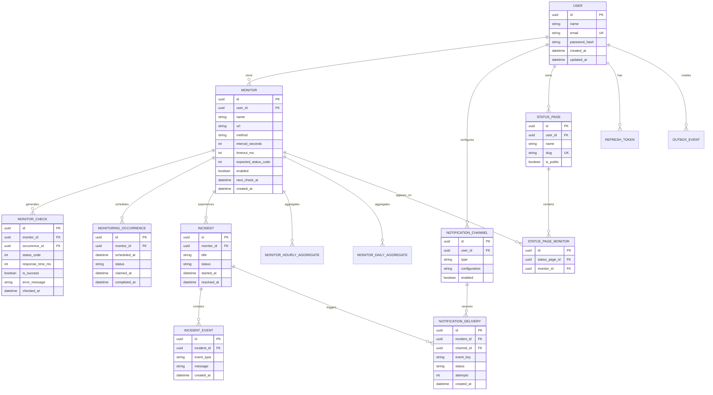

# PulseWatch — Database Design & Schema Specification

**Document:** DATABASE.md  
**Version:** 1.0  
**Status:** Draft — Database Design  
**Project:** PulseWatch  
**Database:** Supabase PostgreSQL  
**ORM:** Prisma

---

# 1. Database Overview

PulseWatch uses PostgreSQL as its primary relational database.

The database is hosted on Supabase and accessed through Prisma ORM.

PostgreSQL is the permanent source of truth for:

- User accounts.
- Monitor configurations.
- Monitoring check results.
- Incident records.
- Incident events.
- Notification configurations.
- Notification delivery history.
- Public status pages.
- Historical performance aggregates.
- Scheduled monitoring occurrences.
- Transactional outbox events.

Redis is used by BullMQ for asynchronous job processing. It is not the permanent storage location for monitoring history or incident records.

## 1.1 Database Technology

| Component | Technology | Responsibility |
|---|---|---|
| Database | PostgreSQL | Persistent data storage |
| Hosting | Supabase | Managed PostgreSQL |
| ORM | Prisma | Database access |
| Migrations | Prisma Migrate | Schema versioning |
| Connection Pooling | Supabase Pooled Connection | Application connections |
| Direct Connection | Supabase Direct Connection | Migrations and direct operations |
| Queue | Redis | Background job coordination |

## 1.2 Database Design Principles

1. Use UUID primary keys.
2. Use foreign keys for relational integrity.
3. Use unique constraints to prevent duplicate records.
4. Use indexes for frequently queried columns.
5. Store timestamps in UTC.
6. Use database transactions for critical operations.
7. Avoid unnecessary data duplication.
8. Use aggregate tables for historical analytics.
9. Implement data retention policies.
10. Keep PostgreSQL as the source of truth.
11. Use explicit deletion policies.
12. Make critical write operations idempotent.

---

# 2. Database Entities

PulseWatch contains the following primary entities.

| Entity | Purpose |
|---|---|
| User | Stores user account information |
| Monitor | Stores registered API endpoints |
| MonitorCheck | Stores individual health-check results |
| MonitoringOccurrence | Tracks scheduled monitoring executions |
| Incident | Stores detected incidents |
| IncidentEvent | Stores incident lifecycle events |
| NotificationChannel | Stores notification configurations |
| NotificationDelivery | Tracks notification delivery |
| StatusPage | Stores public status page configuration |
| StatusPageMonitor | Connects monitors to status pages |
| MonitorHourlyAggregate | Stores hourly performance statistics |
| MonitorDailyAggregate | Stores daily performance statistics |
| OutboxEvent | Stores events awaiting reliable publication |
| RefreshToken | Stores hashed refresh token information |

---

# 3. Entity Relationship Diagram



---

# 4. Database Naming Conventions

Use consistent naming conventions across Prisma and PostgreSQL.

| Element | Convention | Example |
|---|---|---|
| Tables | snake_case | monitor_checks |
| Columns | snake_case | created_at |
| Primary Keys | id | id |
| Foreign Keys | entity_id | monitor_id |
| Indexes | idx_table_columns | idx_monitors_user_id |
| Unique Constraints | uq_table_columns | uq_users_email |
| Enums | PascalCase in Prisma | MonitorStatus |
| Timestamps | UTC | created_at |

Prisma models use PascalCase and map to snake_case PostgreSQL tables.

Example:

```prisma
model MonitorCheck {
  id        String   @id @default(uuid()) @db.Uuid
  monitorId String   @map("monitor_id") @db.Uuid
  checkedAt DateTime @default(now()) @map("checked_at") @db.Timestamptz(6)

  @@map("monitor_checks")
}
```

---

# 5. Detailed Database Schema

## 5.1 User

**Table:** `users`

Stores registered user information.

| Field | PostgreSQL Type | Constraints |
|---|---|---|
| id | UUID | Primary Key |
| name | VARCHAR(100) | NOT NULL |
| email | VARCHAR(255) | UNIQUE, NOT NULL |
| password_hash | TEXT | NOT NULL |
| email_verified_at | TIMESTAMPTZ | NULL |
| created_at | TIMESTAMPTZ | NOT NULL |
| updated_at | TIMESTAMPTZ | NOT NULL |

### Relationships

- One user can own multiple monitors.
- One user can configure multiple notification channels.
- One user can create multiple status pages.
- One user can have multiple refresh tokens.

### Indexes

- Unique index on email.

### Business Rules

- Email addresses must be unique.
- Passwords must never be stored in plaintext.
- Deleting a user requires an explicit data-deletion strategy.

---

## 5.2 Monitor

**Table:** `monitors`

Stores API endpoints registered by users.

| Field | PostgreSQL Type | Constraints |
|---|---|---|
| id | UUID | Primary Key |
| user_id | UUID | Foreign Key |
| name | VARCHAR(100) | NOT NULL |
| url | TEXT | NOT NULL |
| method | HTTP Method | NOT NULL |
| interval_seconds | INTEGER | NOT NULL |
| timeout_ms | INTEGER | NOT NULL |
| expected_status_code | INTEGER | NOT NULL |
| enabled | BOOLEAN | DEFAULT TRUE |
| status | Monitor Status | NOT NULL |
| next_check_at | TIMESTAMPTZ | NULL |
| created_at | TIMESTAMPTZ | NOT NULL |
| updated_at | TIMESTAMPTZ | NOT NULL |

### Default Values

| Field | Default |
|---|---|
| method | GET |
| interval_seconds | 60 |
| timeout_ms | 10000 |
| expected_status_code | 200 |
| enabled | true |
| status | UNKNOWN |

### Monitor Status Enum

```prisma
enum MonitorStatus {
  UNKNOWN
  UP
  DOWN
  PAUSED
}
```

### Relationships

- Belongs to one user.
- Has multiple monitoring checks.
- Has multiple monitoring occurrences.
- Can have multiple historical incidents.
- Has hourly and daily aggregates.
- Can appear on multiple status pages.

### Indexes

- `user_id`
- `enabled, next_check_at`
- `user_id, created_at`

### Business Rules

- Every monitor belongs to one user.
- Only enabled monitors are eligible for scheduling.
- Disabled monitors have status PAUSED.
- Newly created monitors have status UNKNOWN.
- Monitor ownership must be validated before modifications.
- Deleting a monitor must not silently destroy historical incident data.

---

## 5.3 MonitoringOccurrence

**Table:** `monitoring_occurrences`

Tracks individual scheduled monitoring executions.

This entity is important for job idempotency and scheduler reliability.

| Field | PostgreSQL Type | Constraints |
|---|---|---|
| id | UUID | Primary Key |
| monitor_id | UUID | Foreign Key |
| scheduled_at | TIMESTAMPTZ | NOT NULL |
| status | Occurrence Status | NOT NULL |
| claimed_at | TIMESTAMPTZ | NULL |
| lease_expires_at | TIMESTAMPTZ | NULL |
| completed_at | TIMESTAMPTZ | NULL |
| created_at | TIMESTAMPTZ | NOT NULL |

### Occurrence Status Enum

```prisma
enum OccurrenceStatus {
  PENDING
  QUEUED
  PROCESSING
  COMPLETED
  SKIPPED
  FAILED
}
```

### Relationships

- Belongs to one monitor.
- Can generate one monitoring check.

### Constraints

```sql
UNIQUE (monitor_id, scheduled_at)
```

This prevents duplicate scheduled occurrences for the same monitor and scheduled timestamp.

### Indexes

- `(status, created_at)`
- `(lease_expires_at)`
- `(monitor_id, scheduled_at DESC)`

### Business Rules

- Every scheduled execution has a unique occurrence.
- A completed occurrence must not generate another check result.
- Expired leases can be recovered.
- Infrastructure failures must not automatically become failed HTTP observations.
- Missed occurrences should be skipped or coalesced according to the scheduling policy.

---

## 5.4 MonitorCheck

**Table:** `monitor_checks`

Stores the result of every completed HTTP health check.

| Field | PostgreSQL Type | Constraints |
|---|---|---|
| id | UUID | Primary Key |
| monitor_id | UUID | Foreign Key |
| occurrence_id | UUID | Unique Foreign Key |
| status_code | INTEGER | NULL |
| response_time_ms | INTEGER | NULL |
| is_success | BOOLEAN | NOT NULL |
| error_type | VARCHAR(50) | NULL |
| error_message | TEXT | NULL |
| checked_at | TIMESTAMPTZ | NOT NULL |
| created_at | TIMESTAMPTZ | NOT NULL |

### Error Types

Examples:

- TIMEOUT
- DNS_ERROR
- CONNECTION_ERROR
- TLS_ERROR
- INVALID_RESPONSE
- HTTP_ERROR

### Relationships

- Belongs to one monitor.
- Belongs to one scheduled occurrence.

### Constraints

- One check result per scheduled occurrence.
- `response_time_ms` cannot be negative.
- HTTP status codes must be within the valid HTTP status-code range when present.

### Indexes

- `(monitor_id, checked_at DESC)`
- `(monitor_id, is_success, checked_at DESC)`
- `checked_at`

### Business Rules

- Every completed HTTP observation must be recorded.
- Failed HTTP requests must be recorded.
- A request timeout is a failed observation.
- Infrastructure processing failures must not be falsely recorded as endpoint failures.
- Historical records should be retained according to the retention policy.

---

## 5.5 Incident

**Table:** `incidents`

Stores automatically detected monitoring incidents.

| Field | PostgreSQL Type | Constraints |
|---|---|---|
| id | UUID | Primary Key |
| monitor_id | UUID | Foreign Key |
| title | VARCHAR(255) | NOT NULL |
| description | TEXT | NULL |
| status | Incident Status | NOT NULL |
| started_at | TIMESTAMPTZ | NOT NULL |
| resolved_at | TIMESTAMPTZ | NULL |
| created_at | TIMESTAMPTZ | NOT NULL |
| updated_at | TIMESTAMPTZ | NOT NULL |

### Incident Status Enum

```prisma
enum IncidentStatus {
  OPEN
  RECOVERING
  RESOLVED
}
```

### Relationships

- Belongs to one monitor.
- Has multiple incident events.
- Can trigger multiple notification deliveries.

### Indexes

- `(monitor_id, started_at DESC)`
- `(status, started_at DESC)`

### Important Constraint

Only one active incident should exist per monitor.

Use a PostgreSQL partial unique index:

```sql
CREATE UNIQUE INDEX uq_incidents_one_active_per_monitor
ON incidents (monitor_id)
WHERE status IN ('OPEN', 'RECOVERING');
```

### Business Rules

- An incident opens after the configured failure threshold.
- An incident enters RECOVERING after the first successful recovery observation.
- An incident resolves after the configured recovery threshold.
- A new incident can be created after a previous incident is resolved.
- Incident history must remain available.

---

## 5.6 IncidentEvent

**Table:** `incident_events`

Stores every important incident state transition and event.

| Field | PostgreSQL Type | Constraints |
|---|---|---|
| id | UUID | Primary Key |
| incident_id | UUID | Foreign Key |
| event_type | Incident Event Type | NOT NULL |
| message | TEXT | NOT NULL |
| metadata | JSONB | NULL |
| created_at | TIMESTAMPTZ | NOT NULL |

### Event Types

```prisma
enum IncidentEventType {
  INCIDENT_OPENED
  RECOVERY_STARTED
  INCIDENT_REOPENED
  INCIDENT_RESOLVED
}
```

### Relationships

- Belongs to one incident.

### Indexes

- `(incident_id, created_at ASC)`

### Business Rules

- Incident events are immutable.
- Every incident transition creates an event.
- Metadata must not contain sensitive credentials.
- Events must be recorded within the same transaction as their corresponding incident state changes.

---

## 5.7 NotificationChannel

**Table:** `notification_channels`

Stores notification channel configurations.

| Field | PostgreSQL Type | Constraints |
|---|---|---|
| id | UUID | Primary Key |
| user_id | UUID | Foreign Key |
| name | VARCHAR(100) | NOT NULL |
| type | Notification Type | NOT NULL |
| configuration | JSONB | NOT NULL |
| enabled | BOOLEAN | DEFAULT TRUE |
| created_at | TIMESTAMPTZ | NOT NULL |
| updated_at | TIMESTAMPTZ | NOT NULL |

### Notification Type Enum

```prisma
enum NotificationType {
  EMAIL
  SLACK
}
```

### Example Email Configuration

```json
{
  "email": "developer@example.com"
}
```

### Example Slack Configuration

```json
{
  "webhookSecretRef": "secret-reference"
}
```

The actual Slack webhook URL must be stored securely, not exposed through public API responses or logs.

### Relationships

- Belongs to one user.
- Has multiple notification deliveries.

### Business Rules

- Every channel belongs to one user.
- Users can enable or disable channels.
- Sensitive configuration must be encrypted or stored in a secrets manager.
- Configuration must be validated according to channel type.

---

## 5.8 NotificationDelivery

**Table:** `notification_deliveries`

Tracks notification attempts and delivery outcomes.

| Field | PostgreSQL Type | Constraints |
|---|---|---|
| id | UUID | Primary Key |
| incident_id | UUID | Foreign Key |
| channel_id | UUID | Foreign Key |
| event_key | VARCHAR(100) | NOT NULL |
| status | Notification Status | NOT NULL |
| attempts | INTEGER | DEFAULT 0 |
| last_error | TEXT | NULL |
| sent_at | TIMESTAMPTZ | NULL |
| next_retry_at | TIMESTAMPTZ | NULL |
| created_at | TIMESTAMPTZ | NOT NULL |
| updated_at | TIMESTAMPTZ | NOT NULL |

### Notification Status Enum

```prisma
enum NotificationStatus {
  PENDING
  PROCESSING
  SENT
  FAILED
}
```

### Relationships

- Belongs to one incident.
- Belongs to one notification channel.

### Constraints

```sql
UNIQUE (incident_id, channel_id, event_key)
```

### Business Rules

- Each incident event and channel combination must have one logical delivery record.
- Failed deliveries can be retried.
- Duplicate jobs must not create duplicate logical deliveries.
- Monitoring workers must not wait for notification delivery.

---

## 5.9 StatusPage

**Table:** `status_pages`

Stores public status page information.

| Field | PostgreSQL Type | Constraints |
|---|---|---|
| id | UUID | Primary Key |
| user_id | UUID | Foreign Key |
| name | VARCHAR(100) | NOT NULL |
| slug | VARCHAR(100) | UNIQUE, NOT NULL |
| description | TEXT | NULL |
| is_public | BOOLEAN | DEFAULT FALSE |
| created_at | TIMESTAMPTZ | NOT NULL |
| updated_at | TIMESTAMPTZ | NOT NULL |

### Relationships

- Belongs to one user.
- Has multiple status page monitor associations.

### Business Rules

- Public slugs must be unique.
- Only authorized owners can update status pages.
- Unpublished pages must not expose their information publicly.

---

## 5.10 StatusPageMonitor

**Table:** `status_page_monitors`

Connects monitors to public status pages.

| Field | PostgreSQL Type | Constraints |
|---|---|---|
| id | UUID | Primary Key |
| status_page_id | UUID | Foreign Key |
| monitor_id | UUID | Foreign Key |
| display_order | INTEGER | DEFAULT 0 |
| created_at | TIMESTAMPTZ | NOT NULL |

### Constraints

```sql
UNIQUE (status_page_id, monitor_id)
```

### Business Rules

- A monitor can appear on multiple status pages.
- A status page can contain multiple monitors.
- A user cannot associate another user's monitor with their status page.
- Only explicitly selected monitor information can be publicly exposed.

---

## 5.11 MonitorHourlyAggregate

**Table:** `monitor_hourly_aggregates`

Stores hourly monitoring statistics.

| Field | PostgreSQL Type | Constraints |
|---|---|---|
| id | UUID | Primary Key |
| monitor_id | UUID | Foreign Key |
| bucket_start | TIMESTAMPTZ | NOT NULL |
| total_checks | INTEGER | DEFAULT 0 |
| successful_checks | INTEGER | DEFAULT 0 |
| failed_checks | INTEGER | DEFAULT 0 |
| average_response_time_ms | INTEGER | NULL |
| min_response_time_ms | INTEGER | NULL |
| max_response_time_ms | INTEGER | NULL |
| created_at | TIMESTAMPTZ | NOT NULL |
| updated_at | TIMESTAMPTZ | NOT NULL |

### Constraints

```sql
UNIQUE (monitor_id, bucket_start)
```

### Business Rules

- One aggregate exists per monitor per hour.
- Aggregates must be calculated from raw monitoring records.
- Recalculation must be idempotent.
- Only completed monitoring observations are included.

---

## 5.12 MonitorDailyAggregate

**Table:** `monitor_daily_aggregates`

Stores daily monitoring statistics.

| Field | PostgreSQL Type | Constraints |
|---|---|---|
| id | UUID | Primary Key |
| monitor_id | UUID | Foreign Key |
| bucket_start | TIMESTAMPTZ | NOT NULL |
| total_checks | INTEGER | DEFAULT 0 |
| successful_checks | INTEGER | DEFAULT 0 |
| failed_checks | INTEGER | DEFAULT 0 |
| average_response_time_ms | INTEGER | NULL |
| min_response_time_ms | INTEGER | NULL |
| max_response_time_ms | INTEGER | NULL |
| created_at | TIMESTAMPTZ | NOT NULL |
| updated_at | TIMESTAMPTZ | NOT NULL |

### Constraints

```sql
UNIQUE (monitor_id, bucket_start)
```

### Business Rules

- One aggregate exists per monitor per day.
- Daily aggregates can be calculated from hourly aggregates.
- Aggregation jobs must support safe recalculation.
- Use UTC day boundaries consistently.

---

## 5.13 OutboxEvent

**Table:** `outbox_events`

Stores events that must be published reliably to background queues.

| Field | PostgreSQL Type | Constraints |
|---|---|---|
| id | UUID | Primary Key |
| aggregate_type | VARCHAR(100) | NOT NULL |
| aggregate_id | UUID | NOT NULL |
| event_type | VARCHAR(100) | NOT NULL |
| payload | JSONB | NOT NULL |
| status | Outbox Status | NOT NULL |
| attempts | INTEGER | DEFAULT 0 |
| available_at | TIMESTAMPTZ | NOT NULL |
| published_at | TIMESTAMPTZ | NULL |
| created_at | TIMESTAMPTZ | NOT NULL |

### Outbox Status Enum

```prisma
enum OutboxStatus {
  PENDING
  PROCESSING
  PUBLISHED
  FAILED
}
```

### Indexes

- `(status, available_at)`
- `(aggregate_type, aggregate_id)`
- `(created_at)`

### Business Rules

- Events must be created in the same transaction as their domain changes.
- Dispatcher must publish pending events.
- Failed publications must be retryable.
- Publishing must be idempotent.
- Published events must not be silently discarded before the retention period.

---

## 5.14 RefreshToken

**Table:** `refresh_tokens`

Stores refresh token metadata for authentication sessions.

| Field | PostgreSQL Type | Constraints |
|---|---|---|
| id | UUID | Primary Key |
| user_id | UUID | Foreign Key |
| token_hash | TEXT | UNIQUE, NOT NULL |
| expires_at | TIMESTAMPTZ | NOT NULL |
| revoked_at | TIMESTAMPTZ | NULL |
| created_at | TIMESTAMPTZ | NOT NULL |

### Business Rules

- Store only hashed refresh tokens.
- Support token rotation.
- Revoked tokens cannot be reused.
- Expired tokens must be rejected.
- Tokens must be associated with a user.

---

# 6. Database Relationships

| Parent | Child | Relationship |
|---|---|---|
| User | Monitor | One-to-Many |
| User | NotificationChannel | One-to-Many |
| User | StatusPage | One-to-Many |
| User | RefreshToken | One-to-Many |
| Monitor | MonitorCheck | One-to-Many |
| Monitor | MonitoringOccurrence | One-to-Many |
| Monitor | Incident | One-to-Many |
| Monitor | MonitorHourlyAggregate | One-to-Many |
| Monitor | MonitorDailyAggregate | One-to-Many |
| Incident | IncidentEvent | One-to-Many |
| Incident | NotificationDelivery | One-to-Many |
| NotificationChannel | NotificationDelivery | One-to-Many |
| StatusPage | StatusPageMonitor | One-to-Many |
| Monitor | StatusPageMonitor | One-to-Many |

---

# 7. Prisma Schema Design

The following is the canonical initial Prisma model design.

Implementation must use the actual schema below as the basis for Prisma migrations.

```prisma
generator client {
  provider = "prisma-client"
  output   = "../generated/client"
}

datasource db {
  provider = "postgresql"
}

enum MonitorStatus {
  UNKNOWN
  UP
  DOWN
  PAUSED
}

enum MonitorMethod {
  GET
  HEAD
}

enum OccurrenceStatus {
  PENDING
  QUEUED
  PROCESSING
  COMPLETED
  SKIPPED
  FAILED
}

enum IncidentStatus {
  OPEN
  RECOVERING
  RESOLVED
}

enum IncidentEventType {
  INCIDENT_OPENED
  RECOVERY_STARTED
  INCIDENT_REOPENED
  INCIDENT_RESOLVED
}

enum NotificationType {
  EMAIL
  SLACK
}

enum NotificationStatus {
  PENDING
  PROCESSING
  SENT
  FAILED
}

enum OutboxStatus {
  PENDING
  PROCESSING
  PUBLISHED
  FAILED
}

model User {
  id              String @id @default(uuid()) @db.Uuid
  name            String @db.VarChar(100)
  email           String @unique @db.VarChar(255)
  passwordHash    String @map("password_hash")
  emailVerifiedAt DateTime? @map("email_verified_at") @db.Timestamptz(6)

  monitors             Monitor[]
  notificationChannels NotificationChannel[]
  statusPages          StatusPage[]
  refreshTokens        RefreshToken[]

  createdAt DateTime @default(now()) @map("created_at") @db.Timestamptz(6)
  updatedAt DateTime @updatedAt @map("updated_at") @db.Timestamptz(6)

  @@map("users")
}

model Monitor {
  id                 String        @id @default(uuid()) @db.Uuid
  userId             String        @map("user_id") @db.Uuid
  name               String        @db.VarChar(100)
  url                String        @db.Text
  method             MonitorMethod @default(GET)
  intervalSeconds    Int           @default(60) @map("interval_seconds")
  timeoutMs          Int           @default(10000) @map("timeout_ms")
  expectedStatusCode Int           @default(200) @map("expected_status_code")
  enabled            Boolean       @default(true)
  status             MonitorStatus @default(UNKNOWN)
  nextCheckAt        DateTime?     @map("next_check_at") @db.Timestamptz(6)

  user        User                    @relation(fields: [userId], references: [id], onDelete: Restrict)
  checks      MonitorCheck[]
  occurrences MonitoringOccurrence[]
  incidents   Incident[]
  hourly      MonitorHourlyAggregate[]
  daily       MonitorDailyAggregate[]
  statusPages StatusPageMonitor[]

  createdAt DateTime @default(now()) @map("created_at") @db.Timestamptz(6)
  updatedAt DateTime @updatedAt @map("updated_at") @db.Timestamptz(6)

  @@index([userId])
  @@index([userId, createdAt])
  @@index([nextCheckAt], map: "idx_monitors_next_check_at")
  @@map("monitors")
}

model MonitoringOccurrence {
  id             String           @id @default(uuid()) @db.Uuid
  monitorId      String           @map("monitor_id") @db.Uuid
  scheduledAt    DateTime         @map("scheduled_at") @db.Timestamptz(6)
  status         OccurrenceStatus  @default(PENDING)
  claimedAt      DateTime?        @map("claimed_at") @db.Timestamptz(6)
  leaseExpiresAt DateTime?        @map("lease_expires_at") @db.Timestamptz(6)
  completedAt    DateTime?        @map("completed_at") @db.Timestamptz(6)

  monitor Monitor       @relation(fields: [monitorId], references: [id], onDelete: Restrict)
  check   MonitorCheck?

  createdAt DateTime @default(now()) @map("created_at") @db.Timestamptz(6)

  @@unique([monitorId, scheduledAt])
  @@index([status, createdAt])
  @@index([leaseExpiresAt])
  @@index([monitorId, scheduledAt(sort: Desc)])
  @@map("monitoring_occurrences")
}

model MonitorCheck {
  id                 String   @id @default(uuid()) @db.Uuid
  monitorId          String   @map("monitor_id") @db.Uuid
  occurrenceId       String   @unique @map("occurrence_id") @db.Uuid
  statusCode         Int?     @map("status_code")
  responseTimeMs     Int?     @map("response_time_ms")
  isSuccess          Boolean  @map("is_success")
  errorType          String?  @map("error_type") @db.VarChar(50)
  errorMessage       String?  @map("error_message") @db.Text
  checkedAt          DateTime @map("checked_at") @db.Timestamptz(6)

  monitor    Monitor              @relation(fields: [monitorId], references: [id], onDelete: Restrict)
  occurrence MonitoringOccurrence @relation(fields: [occurrenceId], references: [id], onDelete: Restrict)

  createdAt DateTime @default(now()) @map("created_at") @db.Timestamptz(6)

  @@index([monitorId, checkedAt(sort: Desc)])
  @@index([monitorId, isSuccess, checkedAt(sort: Desc)])
  @@index([checkedAt])
  @@map("monitor_checks")
}

model Incident {
  id          String        @id @default(uuid()) @db.Uuid
  monitorId   String        @map("monitor_id") @db.Uuid
  title       String        @db.VarChar(255)
  description String?       @db.Text
  status      IncidentStatus @default(OPEN)
  startedAt   DateTime      @default(now()) @map("started_at") @db.Timestamptz(6)
  resolvedAt  DateTime?     @map("resolved_at") @db.Timestamptz(6)

  monitor               Monitor                @relation(fields: [monitorId], references: [id], onDelete: Restrict)
  events                IncidentEvent[]
  notificationDeliveries NotificationDelivery[]

  createdAt DateTime @default(now()) @map("created_at") @db.Timestamptz(6)
  updatedAt DateTime @updatedAt @map("updated_at") @db.Timestamptz(6)

  @@index([monitorId, startedAt(sort: Desc)])
  @@index([status, startedAt(sort: Desc)])
  @@map("incidents")
}

model IncidentEvent {
  id        String            @id @default(uuid()) @db.Uuid
  incidentId String           @map("incident_id") @db.Uuid
  eventType IncidentEventType @map("event_type")
  message   String            @db.Text
  metadata  Json?
  createdAt DateTime          @default(now()) @map("created_at") @db.Timestamptz(6)

  incident Incident @relation(fields: [incidentId], references: [id], onDelete: Restrict)

  @@index([incidentId, createdAt])
  @@map("incident_events")
}

model NotificationChannel {
  id            String           @id @default(uuid()) @db.Uuid
  userId        String           @map("user_id") @db.Uuid
  name          String           @db.VarChar(100)
  type          NotificationType
  configuration Json
  enabled       Boolean          @default(true)

  user     User                   @relation(fields: [userId], references: [id], onDelete: Restrict)
  deliveries NotificationDelivery[]

  createdAt DateTime @default(now()) @map("created_at") @db.Timestamptz(6)
  updatedAt DateTime @updatedAt @map("updated_at") @db.Timestamptz(6)

  @@index([userId, enabled])
  @@map("notification_channels")
}

model NotificationDelivery {
  id          String             @id @default(uuid()) @db.Uuid
  incidentId  String             @map("incident_id") @db.Uuid
  channelId   String             @map("channel_id") @db.Uuid
  eventKey    String             @map("event_key") @db.VarChar(100)
  status      NotificationStatus @default(PENDING)
  attempts    Int                @default(0)
  lastError   String?            @map("last_error") @db.Text
  sentAt      DateTime?          @map("sent_at") @db.Timestamptz(6)
  nextRetryAt DateTime?          @map("next_retry_at") @db.Timestamptz(6)

  incident Incident           @relation(fields: [incidentId], references: [id], onDelete: Restrict)
  channel  NotificationChannel @relation(fields: [channelId], references: [id], onDelete: Restrict)

  createdAt DateTime @default(now()) @map("created_at") @db.Timestamptz(6)
  updatedAt DateTime @updatedAt @map("updated_at") @db.Timestamptz(6)

  @@unique([incidentId, channelId, eventKey])
  @@index([status, nextRetryAt])
  @@map("notification_deliveries")
}

model StatusPage {
  id          String  @id @default(uuid()) @db.Uuid
  userId      String  @map("user_id") @db.Uuid
  name        String  @db.VarChar(100)
  slug        String  @unique @db.VarChar(100)
  description String? @db.Text
  isPublic    Boolean @default(false) @map("is_public")

  user    User                @relation(fields: [userId], references: [id], onDelete: Restrict)
  monitors StatusPageMonitor[]

  createdAt DateTime @default(now()) @map("created_at") @db.Timestamptz(6)
  updatedAt DateTime @updatedAt @map("updated_at") @db.Timestamptz(6)

  @@index([userId])
  @@map("status_pages")
}

model StatusPageMonitor {
  id           String   @id @default(uuid()) @db.Uuid
  statusPageId String   @map("status_page_id") @db.Uuid
  monitorId    String   @map("monitor_id") @db.Uuid
  displayOrder Int      @default(0) @map("display_order")

  statusPage StatusPage @relation(fields: [statusPageId], references: [id], onDelete: Restrict)
  monitor    Monitor    @relation(fields: [monitorId], references: [id], onDelete: Restrict)

  createdAt DateTime @default(now()) @map("created_at") @db.Timestamptz(6)

  @@unique([statusPageId, monitorId])
  @@map("status_page_monitors")
}

model MonitorHourlyAggregate {
  id                    String   @id @default(uuid()) @db.Uuid
  monitorId             String   @map("monitor_id") @db.Uuid
  bucketStart           DateTime @map("bucket_start") @db.Timestamptz(6)
  totalChecks           Int      @default(0) @map("total_checks")
  successfulChecks      Int      @default(0) @map("successful_checks")
  failedChecks          Int      @default(0) @map("failed_checks")
  averageResponseTimeMs Int?     @map("average_response_time_ms")
  minResponseTimeMs     Int?     @map("min_response_time_ms")
  maxResponseTimeMs     Int?     @map("max_response_time_ms")

  monitor Monitor @relation(fields: [monitorId], references: [id], onDelete: Restrict)

  createdAt DateTime @default(now()) @map("created_at") @db.Timestamptz(6)
  updatedAt DateTime @updatedAt @map("updated_at") @db.Timestamptz(6)

  @@unique([monitorId, bucketStart])
  @@index([monitorId, bucketStart(sort: Desc)])
  @@map("monitor_hourly_aggregates")
}

model MonitorDailyAggregate {
  id                    String   @id @default(uuid()) @db.Uuid
  monitorId             String   @map("monitor_id") @db.Uuid
  bucketStart           DateTime @map("bucket_start") @db.Timestamptz(6)
  totalChecks           Int      @default(0) @map("total_checks")
  successfulChecks      Int      @default(0) @map("successful_checks")
  failedChecks          Int      @default(0) @map("failed_checks")
  averageResponseTimeMs Int?     @map("average_response_time_ms")
  minResponseTimeMs     Int?     @map("min_response_time_ms")
  maxResponseTimeMs     Int?     @map("max_response_time_ms")

  monitor Monitor @relation(fields: [monitorId], references: [id], onDelete: Restrict)

  createdAt DateTime @default(now()) @map("created_at") @db.Timestamptz(6)
  updatedAt DateTime @updatedAt @map("updated_at") @db.Timestamptz(6)

  @@unique([monitorId, bucketStart])
  @@index([monitorId, bucketStart(sort: Desc)])
  @@map("monitor_daily_aggregates")
}

model OutboxEvent {
  id            String       @id @default(uuid()) @db.Uuid
  aggregateType String       @map("aggregate_type") @db.VarChar(100)
  aggregateId   String       @map("aggregate_id") @db.Uuid
  eventType     String       @map("event_type") @db.VarChar(100)
  payload       Json
  status        OutboxStatus @default(PENDING)
  attempts      Int          @default(0)
  availableAt   DateTime     @default(now()) @map("available_at") @db.Timestamptz(6)
  publishedAt   DateTime?    @map("published_at") @db.Timestamptz(6)

  createdAt DateTime @default(now()) @map("created_at") @db.Timestamptz(6)

  @@index([status, availableAt])
  @@index([aggregateType, aggregateId])
  @@map("outbox_events")
}

model RefreshToken {
  id        String    @id @default(uuid()) @db.Uuid
  userId    String    @map("user_id") @db.Uuid
  tokenHash String    @unique @map("token_hash") @db.Text
  expiresAt DateTime  @map("expires_at") @db.Timestamptz(6)
  revokedAt DateTime? @map("revoked_at") @db.Timestamptz(6)

  user User @relation(fields: [userId], references: [id], onDelete: Cascade)

  createdAt DateTime @default(now()) @map("created_at") @db.Timestamptz(6)

  @@index([userId])
  @@index([expiresAt])
  @@map("refresh_tokens")
}
```

**Implementation notes:**

- The schema uses the modern Prisma `prisma-client` generator. Confirm your installed Prisma version and generator configuration before implementation.
- Some PostgreSQL-specific constraints and partial indexes require custom SQL migration files.
- Validate enum values, numeric ranges, JSON configurations, and cross-user relationships at the application and database levels.
- `@updatedAt` is maintained by Prisma, not by a PostgreSQL trigger.
- The occurrence-to-check relationship is one-to-zero-or-one.
- The partial unique incident index must be created in a custom migration.

---

# 8. Database Constraints and Indexes

## 8.1 Critical Unique Constraints

| Table | Constraint |
|---|---|
| users | Unique email |
| monitoring_occurrences | Unique monitor_id + scheduled_at |
| monitor_checks | Unique occurrence_id |
| incidents | One active incident per monitor |
| notification_deliveries | Unique incident_id + channel_id + event_key |
| status_pages | Unique slug |
| status_page_monitors | Unique status_page_id + monitor_id |
| monitor_hourly_aggregates | Unique monitor_id + bucket_start |
| monitor_daily_aggregates | Unique monitor_id + bucket_start |
| refresh_tokens | Unique token_hash |

## 8.2 Critical Indexes

```sql
CREATE INDEX idx_monitors_due
ON monitors (next_check_at)
WHERE enabled = true;

CREATE INDEX idx_checks_monitor_time
ON monitor_checks (monitor_id, checked_at DESC);

CREATE INDEX idx_checks_monitor_success
ON monitor_checks (monitor_id, is_success, checked_at DESC);

CREATE INDEX idx_occurrences_status
ON monitoring_occurrences (status, created_at);

CREATE INDEX idx_occurrences_lease
ON monitoring_occurrences (lease_expires_at);

CREATE INDEX idx_incidents_monitor_time
ON incidents (monitor_id, started_at DESC);

CREATE INDEX idx_incidents_status
ON incidents (status, started_at DESC);

CREATE INDEX idx_notification_pending
ON notification_deliveries (status, next_retry_at);

CREATE INDEX idx_outbox_pending
ON outbox_events (status, available_at);
```

Indexes must be validated against actual query patterns using PostgreSQL EXPLAIN ANALYZE.

Avoid adding indexes to every column because indexes increase storage consumption and write overhead.

---

# 9. Database Transaction Boundaries

Critical business operations must use database transactions.

## 9.1 Monitor Creation

Transaction responsibilities:

1. Validate user ownership.
2. Create monitor.
3. Initialize scheduling information.
4. Commit transaction.

## 9.2 Monitoring Result Persistence

Transaction responsibilities:

1. Verify occurrence state.
2. Insert monitoring result.
3. Mark occurrence completed.
4. Update monitor's latest status.
5. Commit transaction.

The occurrence must only be completed once.

## 9.3 Incident Creation

Transaction responsibilities:

1. Lock or conditionally update monitor incident state.
2. Verify failure threshold.
3. Create incident.
4. Create incident event.
5. Create outbox event.
6. Commit transaction.

## 9.4 Incident Resolution

Transaction responsibilities:

1. Verify recovery threshold.
2. Update incident status.
3. Set resolution timestamp.
4. Create incident event.
5. Create outbox event.
6. Commit transaction.

## 9.5 Notification Delivery

Transaction responsibilities:

1. Claim notification delivery.
2. Update attempt state.
3. Commit claim.
4. Send external notification.
5. Persist delivery outcome.

Never hold a database transaction open while waiting for an external email or Slack request.

---

# 10. Idempotency Strategy

Idempotency prevents duplicate writes when jobs are retried.

| Operation | Idempotency Strategy |
|---|---|
| Monitor scheduling | Unique monitor + scheduled timestamp |
| Monitoring result | Unique occurrence ID |
| Incident creation | Partial unique active incident index |
| Incident event | Unique event identifier or transition key |
| Notification creation | Unique incident + channel + event key |
| Aggregate updates | Unique monitor + bucket timestamp |
| Outbox publishing | Stable event ID |

Important:

BullMQ provides job processing capabilities, but the application must still enforce idempotency in PostgreSQL.

Do not assume that queue-level job deduplication alone guarantees exactly-once database writes.

---

# 11. Uptime Calculation

Uptime is calculated from completed HTTP observations.

## 11.1 Formula

```text
Uptime Percentage =
(Successful Checks / Total Valid Checks) * 100
```

Example:

```text
Total Checks: 1000
Successful Checks: 990
Failed Checks: 10

Uptime = (990 / 1000) * 100

Uptime = 99%
```

## 11.2 Query Example

```sql
SELECT
    monitor_id,
    COUNT(*) AS total_checks,
    COUNT(*) FILTER (WHERE is_success = TRUE) AS successful_checks,
    COUNT(*) FILTER (WHERE is_success = FALSE) AS failed_checks,
    ROUND(
        COUNT(*) FILTER (WHERE is_success = TRUE) * 100.0
        / NULLIF(COUNT(*), 0),
        2
    ) AS uptime_percentage
FROM monitor_checks
WHERE checked_at >= NOW() - INTERVAL '24 hours'
GROUP BY monitor_id;
```

## 11.3 Important Rules

- Exclude incomplete checks.
- Include actual failed HTTP observations.
- Do not count infrastructure processing failures as endpoint failures.
- Missing monitoring data must not be interpreted as successful uptime.
- Use explicit UTC time boundaries.
- Document whether uptime is check-based availability or time-weighted availability.

For the MVP, use check-based availability.

---

# 12. Response-Time Aggregation

Calculate response-time statistics using completed checks with valid response measurements.

Example:

```sql
SELECT
    monitor_id,
    AVG(response_time_ms) AS average_response_time,
    MIN(response_time_ms) AS minimum_response_time,
    MAX(response_time_ms) AS maximum_response_time
FROM monitor_checks
WHERE checked_at >= NOW() - INTERVAL '24 hours'
  AND response_time_ms IS NOT NULL
GROUP BY monitor_id;
```

Failed requests without a completed HTTP response should have a NULL response time.

For future analytics, consider storing percentiles such as p50, p95, and p99.

---

# 13. Data Retention Policy

Raw monitoring history can grow quickly.

Initial retention strategy:

| Data | Retention |
|---|---|
| Raw monitor checks | 30 days |
| Hourly aggregates | 90 days |
| Daily aggregates | 1 year |
| Incident history | Indefinite |
| Incident events | Indefinite |
| Notification deliveries | 90 days |
| Published outbox events | 7 days |
| Expired refresh tokens | 30 days after expiry |

## 13.1 Retention Workflow

A scheduled maintenance worker must:

1. Identify expired records.
2. Delete eligible raw check history.
3. Delete expired notification delivery records.
4. Delete old published outbox records.
5. Delete expired refresh tokens.
6. Preserve incident history.
7. Log cleanup results.

## 13.2 Important Considerations

- Aggregates must be calculated before raw data is deleted.
- Retention jobs must be idempotent.
- Delete records in batches.
- Avoid large transactions.
- Monitor database storage usage.

For high monitoring volumes, consider time-based partitioning of `monitor_checks` after validating PostgreSQL operational requirements.

---

# 14. Database Security

Requirements:

1. Use environment variables for database credentials.
2. Never commit connection strings.
3. Use encrypted database connections.
4. Use restricted database credentials where practical.
5. Validate ownership before database modifications.
6. Never expose sensitive notification configuration.
7. Encrypt sensitive integration secrets.
8. Avoid logging database credentials.
9. Use migrations for schema changes.
10. Validate JSON configuration payloads.

The database must not rely exclusively on frontend validation for data integrity.

---

# 15. Database Migration Strategy

Use Prisma Migrate.

## 15.1 Development Migration

```bash
pnpm prisma migrate dev --name init
```

## 15.2 Generate Prisma Client

```bash
pnpm prisma generate
```

## 15.3 Apply Production Migrations

```bash
pnpm prisma migrate deploy
```

## 15.4 Inspect Database

```bash
pnpm prisma studio
```

## 15.5 Migration Rules

- Never manually modify production schema.
- Every schema change must have a migration.
- Review generated SQL before applying migrations.
- Test migrations against a development database.
- Preserve existing data during schema changes.
- Use custom SQL migrations for PostgreSQL-specific constraints.
- Never use `db push` as a production migration strategy.

---

# 16. Database Performance Considerations

## 16.1 Query Optimization

- Use indexed filtering.
- Avoid unnecessary SELECT * queries.
- Implement pagination.
- Avoid N+1 queries.
- Use aggregate tables for historical analytics.
- Use raw SQL for complex PostgreSQL-specific queries when necessary.

## 16.2 Connection Management

- Reuse Prisma Client instances.
- Avoid creating one Prisma Client per request or job.
- Configure appropriate connection pool limits.
- Account for the combined connection usage of API, scheduler, and workers.
- Use Supabase pooling where appropriate.

## 16.3 Monitoring History

The monitoring history table is expected to become one of the largest tables.

Use:

- Time-based indexes.
- Retention cleanup.
- Hourly aggregates.
- Daily aggregates.
- Batch inserts where appropriate.
- Partitioning when justified by actual scale.

---

# 17. Database Backup and Recovery

Requirements:

- Use Supabase-supported backup and recovery capabilities.
- Configure appropriate recovery objectives.
- Test database restoration procedures.
- Preserve migration history.
- Keep application deployment independent from database backups.
- Monitor database availability.

Redis must not be treated as a backup of PostgreSQL.

---

# 18. Definition of Database Completion

The database design is ready for implementation when:

- [ ] All entities are defined.
- [ ] All relationships are defined.
- [ ] Prisma models are implemented.
- [ ] Enums are implemented.
- [ ] Foreign keys are configured.
- [ ] Unique constraints are configured.
- [ ] Required indexes are created.
- [ ] Partial unique incident index is implemented.
- [ ] Monitoring occurrence idempotency is implemented.
- [ ] Transaction boundaries are documented.
- [ ] Notification delivery tracking is implemented.
- [ ] Transactional outbox is implemented.
- [ ] Uptime calculation is verified.
- [ ] Aggregation strategy is implemented.
- [ ] Retention jobs are implemented.
- [ ] Database migrations are tested.

---

# 19. Final Database Architecture Principle

PostgreSQL is the permanent source of truth.

Prisma provides type-safe database access.

Monitoring occurrences guarantee unique scheduled executions.

Monitor checks preserve health-check history.

Incidents represent service failures and recovery.

Incident events provide an immutable timeline.

Notification deliveries track communication attempts.

Outbox events provide reliable event publication.

Hourly and daily aggregates support efficient analytics.

Redis/BullMQ coordinates background processing but does not replace PostgreSQL.

**Every important business operation must preserve database consistency, support safe retries, and prevent duplicate records.**

---

**Document End**
